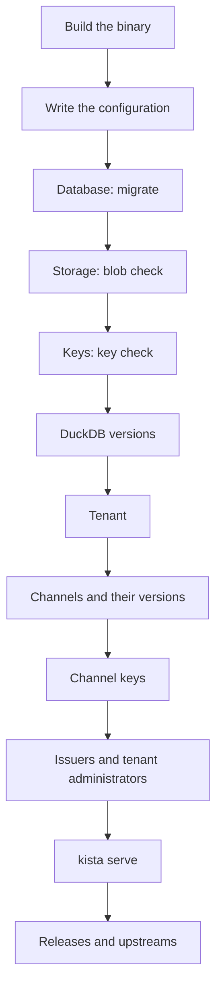

# Administration

This section is the operator's view of kista: who administers what, where each task is done, and
the order of the first day's setup. The pages below go into each task:

| Page | What it covers |
| --- | --- |
| [Command reference](commands.md) | every `kista` command, its flags, output and exit status |
| [Tenants and channels](tenants-and-channels.md) | tenants, storage domains, channels and their kinds, keys, issuers, tenant administrators |
| [Key rotation](key-rotation.md) | key states, re-signing, what DuckDB clients see, emergency revocation, attestation keys |
| [Upgrading](upgrading.md) | migrations, `store.migrate`, `min_reader`, rolling upgrades with several replicas |
| [Backup and restore](backup-restore.md) | the state kista keeps, backup order, restoring and verifying bodies |

## Roles

| Role | Who | Acts through | May do |
| --- | --- | --- | --- |
| **Server administrator** | whoever runs `kista admin` as the service's OS user; or a principal listed in `auth.server_admins`, with a token from a server issuer (`auth.server_issuers`) carrying a server audience | the CLI; the API and the console with a server token | everything, in every tenant |
| **Tenant administrator** | a principal of one of the tenant's issuers holding a tenant-wide `admin` grant | the API and the console with a tenant token | the tenant's issuers, grants, extension groups, publishers, upstreams, feeds, channels and releases |
| **Channel administrator** | `admin` granted on one channel | the API and the console | that channel's DuckDB versions, key activation and retirement, releases |
| **Extension administrator** | `admin` granted on one extension or extension group (in a channel or all) | the API and the console | that extension's releases; its attachments with a grant in every channel |
| **Auditor** | the `audit` verb on the tenant | the API and the console | reading the tenant's events, statistics and attachments |

Some operations are **server-only**, whatever the grant, in the CLI and the API alike:

- creating, suspending and resuming tenants; choosing a tenant's storage domain;
- adding DuckDB versions and their C API maxima;
- assigning token audiences to tenants;
- registering a key by signer reference (channel keys and attestation keys);
- `force` on key activation and retirement;
- storage operations: `blob check`, `blob verify`, `blob gc` (CLI only).

Server administrators come from the configuration file (`auth.server_issuers`, `auth.server_admins`)
and change only with a restart. Tenant administrators are grants in the database and change at
once. A token is either a server token or a tenant token, never both: see [Access](../access.md).

## Where each task is done

`kista admin` covers everything. The [HTTP API](../api.md) covers what tenant administrators do and
most server tasks. The [console](../console.md) at `/ui/` is a UI over the API; it adds no rights of
its own.

| Task | CLI (`kista admin`) | API | Console |
| --- | --- | --- | --- |
| Migrate or check the schema | `migrate`, `check` | no | no |
| Back up a SQLite database | `backup` | no | no |
| Storage checks, verification, garbage collection | `blob check`, `blob verify`, `blob gc` | no | no |
| Check a key in a key source | `key check` | no | no |
| DuckDB versions | `version` | server | server view |
| Tenants, suspend and resume | `tenant` | server | server view |
| Tenant audiences | `tenant audience` | server (tenant admins read) | yes |
| Channels and their DuckDB versions | `channel` | tenant or channel admin | yes |
| Register a channel key | `key add` | server | server, in the key view |
| Activate or retire a key | `key activate`, `key retire` | channel admin (`force`: server) | yes |
| Re-sign a channel | `key resign` | no (replicas with `serve.resign` do it) | progress in the key view |
| Releases: add a build | `release add` | publication route ([Publishing](../publishing.md)) | no |
| Releases: yank, deprecate, current, visibility, purge | `release` | extension admin | yes |
| Promote releases between channels | `release promote` | the `promote` verb | no |
| Blocks | `block` | tenant admin | yes |
| Issuers, console clients, grants, extension groups | `issuer`, `grant`, `extension-group` | tenant admin | yes |
| Publishers, GitHub credentials, API keys | `publisher` | tenant admin | yes |
| Upstreams, shadows | `upstream`, `shadow` | tenant admin | yes |
| Attachments | `attachment` | extension admin, publishers (SBOM and provenance); `readers` and feedable: tenant admin | yes |
| Attestation keys | `attestation-key` | add: server; activate and retire: tenant admin | no |
| Feeds | `feed` | tenant admin | yes |
| Events | `events list` | tenant admins and auditors; server events for server admins | yes |

## Day-one setup

The order matters: each step needs the one before. [Getting started](../getting-started.md) does a
minimal version on one machine.

1. **Build** `bin/kista` with `make build` (`make console` first to embed the console). There is no
   container image or package yet.
2. **Write the configuration** ([Configuration](../configuration.md)): `profile`, `store`,
   `blob.domains` (with `default`), `signers` (key sources), `serve` (listeners, `public_url`),
   `auth` (server issuers and administrators), `egress`.
3. **Prepare the database** ([State](../state.md)): `kista admin -config kista.yaml migrate`, or let
   `kista serve` migrate with `store.migrate: auto`.
4. **Check the storage**: `kista admin -config kista.yaml blob check` pins each domain to its store
   and writes its marker ([Storage](../storage.md)).
5. **Check each signing key**: `kista admin -config kista.yaml key check -signer <ref>`
   ([Signing keys](../signing-keys.md)).
6. **Register DuckDB versions**: `version add` with their C API maxima.
7. **Create the tenant**: `tenant create`, with `-domain` if it does not live in `default`.
8. **Create channels**: `channel create` (`signed` or `passthrough`), then `channel versions -add`.
9. **Bind keys** to each signed channel: `key add <tenant>/<channel> -signer <ref> -active`.
10. **Issuers and administrators**: `issuer add`, `tenant audience add` if the issuer cannot use the
    canonical audience, `grant add -verb admin` for the tenant's administrators, and
    `issuer console` for the console's sign-in.
11. **Start** `kista serve` and check `/readyz`.
12. **Fill the channels**: `release add`, publishers ([Publishing](../publishing.md)), upstreams
    ([Upstreams](../upstreams.md)); grants for `install` on private extensions
    ([Access](../access.md)).

Steps 6 to 10 are the [Tenants and channels](tenants-and-channels.md) page.

## Routine operations

- **Watch events**: `kista admin events list -server`, `kista admin events list <tenant>`, or a
  sink ([Observability](../observability.md)).
- **Verify storage**: a quick `blob verify` daily from cron, `blob verify -full` monthly
  ([Backup and restore](backup-restore.md)).
- **Collect garbage**: set `gc.interval` once every replica runs a version that supports it, or run
  `blob gc -apply` by hand ([Storage](../storage.md)).
- **Rotate keys** on a schedule, and know the emergency procedure ([Key rotation](key-rotation.md)).
- **Back up** the database, then the blob storage ([Backup and restore](backup-restore.md)).
- **Upgrade** with attention to `min_reader` ([Upgrading](upgrading.md)).
