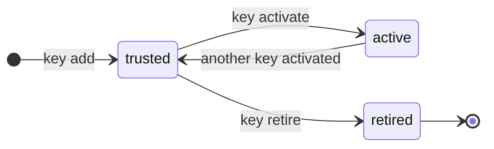

# Key rotation

Every signed channel has its own key set: one **active** key that signs new releases, and
**trusted** keys that clients also accept. DuckDB pins a repository's keys when the repository is
created (`CREATE EXTENSION REPOSITORY`) and checks the signature on **every** `LOAD`, not only at
`INSTALL`. Rotation is therefore a procedure over time, and kista enforces its order. The design is
in [spec 0003](https://github.com/hugr-lab/duckdb-extension-repository/blob/main/specs/0003-store-tenants-keys/spec.md)
and [spec 0006](https://github.com/hugr-lab/duckdb-extension-repository/blob/main/specs/0006-serve/spec.md).

In the examples, `ka` stands for `kista admin -config /etc/kista/kista.yaml`.

## Key states



| State | In `.well-known` | Signs new releases |
| --- | --- | --- |
| `trusted` | yes | no |
| `active` | yes | yes, exactly one per signed channel |
| `retired` | no | no; never comes back |

Besides the active key, each channel has a **serving key**: the key whose signature every answer
carries. Every release that is not yanked has a signature by the serving key. The serving key is set
by the channel's first release and moves to the active key only when a re-sign has signed every
release with it.

`.well-known` lists the active key first, then trusted keys in the order they were trusted.
`ka wellknown acme/prod` prints the exact document.

## Timing rules

| Rule | Setting | Default |
| --- | --- | --- |
| A key must be trusted this long before it is activated, counted from when it was added (a demotion does not reset it) | `rotation.min_trusted` | `168h` (7 days) |
| A key must have left the active state this long before it is retired; a key that was never active counts from when it was added | `rotation.min_demoted` | `168h` (7 days) |

Both cannot be set below `rotation.min_floor` (`24h` by default; file-only) unless `profile: dev`.
They can be set from the environment
(`KISTA_ROTATION__MIN_TRUSTED`, `KISTA_ROTATION__MIN_DEMOTED`). See
[Configuration](../configuration.md).

`-force` skips the waiting time. It is for server administrators only (the CLI, or `?force=true` on
the API with a server token), and the key history records the step as forced. `-force` never
allows retiring the active key or the serving key.

A key demoted by a rollback can be activated again at once: it is still trusted, and clients
already have it.

## A planned rotation

### 1. Add the new key as trusted

```bash
ka key check -signer prod:ext-acme-prod-2/9a8b...
ka key add acme/prod -signer prod:ext-acme-prod-2/9a8b...
ka key list acme/prod
```

The new key is published in `.well-known` at once, but signs nothing yet.

### 2. Let clients learn the new key

A DuckDB client only knows the keys it read when its repository was created. During the
`min_trusted` period, clients recreate the repository so they pin both keys:

```sql
CREATE OR REPLACE EXTENSION REPOSITORY corp WITH PREFIX 'https://extensions.example.com/acme/prod';
```

`.well-known` is served with `Cache-Control: public, no-cache`, so a `CREATE OR REPLACE` sees the
current keys. A client can also pass keys explicitly with `USING PUBLIC KEY`. See
[Using kista from DuckDB](../duckdb.md).

### 3. Activate the new key

```bash
ka key activate acme/prod <key id or fingerprint>
```

The old active key becomes trusted. New releases are signed by the new key. Existing releases are
still served with the serving key's signature (the old key) until a re-sign.

### 4. Re-sign the channel

Re-signing adds the active key's signature to every non-yanked release of the channel, then moves
the serving key to the active key. Signatures are made outside any transaction and stored in batches
of 32 under the channel's lock; the serving key moves in a final transaction, only once no
non-yanked release lacks the active key's signature. A re-sign that stops half-way is simply run
again. Bodies are untouched: only signature rows are added. Two ways to run it:

- **Automatically**: `kista serve` with `serve.resign: true` runs the re-signer. One replica at a
  time per channel holds its lease. Leave it off on replicas that should not have signing access.
- **In the foreground**: `ka key resign acme/prod`. It prints how many signatures it made and
  whether the serving key moved.

If no replica has `serve.resign` and nobody runs `key resign`, the serving key never moves.
Check progress with `GET /api/v1/tenants/{t}/channels/{c}/keys` or the console's key view: it shows
the serving key, the active key, the releases not yet signed by the active key, and when a
re-signer last held the channel.

After the serving key moves, clients get files signed by the new key. Files a client installed
earlier are still signed by the old key, and keep loading because the client still trusts it.

### 5. Let clients reinstall, then retire the old key

Clients replace their files with `FORCE INSTALL x FROM corp` (DuckDB's `UPDATE EXTENSIONS` does not
cover extensions from a kista channel). After `min_demoted`:

```bash
ka key retire acme/prod <old key id or fingerprint>
ka key events acme/prod
```

The retired key leaves `.well-known`. A client that then recreates its repository no longer trusts
the old key, and any file still signed by it fails to `LOAD` until it is reinstalled.

Retirement is refused for the active key and for the serving key (activate another key and re-sign
first).

## How clients see a rotation

| Step | `.well-known` | Files served | Installed files on a client that recreated its repository after step 1 |
| --- | --- | --- | --- |
| after 1 | old (active), new | signed by old | load |
| after 3 | new (active), old | signed by old | load |
| after 4 | new (active), old | signed by new | load |
| after 5 | new (active) | signed by new | files still signed by old fail `LOAD` after the next recreate, until `FORCE INSTALL` |

A client that never recreates keeps only the keys it pinned originally: after step 4 it cannot load
newly installed files until it recreates the repository.

Running servers pick up key changes made by `kista admin` or the API at their next request: every
key change bumps the channel's version, which keys the server's caches.

## Emergency revocation

When a key is compromised, the goal is to stop it from being trusted as fast as clients allow. kista
removes it from `.well-known`; clients drop it when they recreate their repository. A yanked release
stays loadable on clients that installed it, because they trust its key: only a key rotation
revokes a binary everywhere.

A server administrator runs the rotation with `-force`:

```bash
ka key add acme/prod -signer prod:ext-acme-prod-3/7c6d...   # 1. a new key
ka key activate acme/prod <new key> -force                  # 2. active now
ka key resign acme/prod                                     # 3. sign every release, move the serving key
ka key retire acme/prod <compromised key> -force            # 4. out of .well-known
ka key events acme/prod                                     # forced steps are recorded
```

Then:

- tell clients to recreate the repository and `FORCE INSTALL` what they use;
- consider yanking or blocking releases that the compromised key may have been used to forge
  (`ka block add`), see [Publishing](../publishing.md);
- disable the key in its key source once it is retired. kista signs only with the active key and,
  while it differs, the serving key, so a retired key is never used again.

Until a client recreates its repository, it still trusts the compromised key; kista cannot change
that.

## Attestation keys

A tenant that serves a feed of signed statements (see [Attachments](../attachments.md)) has
**attestation keys**: RSA-2048 keys in a key source, separate from channel keys (a fingerprint
belongs to one role on the server). They follow the same states and the same `min_trusted` and
`min_demoted` rules, with one active key per tenant.

```bash
ka attestation-key add acme prod:att-acme-2/5e4f...        # trusted
ka attestation-key list acme
ka attestation-key activate acme <id or fingerprint>        # after min_trusted, or -force
ka attestation-key retire acme <old id or fingerprint>      # after min_demoted, or -force
```

- A server administrator registers a key (CLI or `POST /api/v1/tenants/{t}/attestation-keys`);
  tenant administrators activate and retire over the API.
- The public keys and their states are published at
  `GET /api/v1/tenants/{t}/attestation-keys`, retired ones included, so statements signed earlier
  still verify.
- Only a trusted key can be retired; the active one cannot.
- Subscribers verify statements against the fingerprints they **pinned**. Rotation is a new key that
  subscribers pin before it signs: once the new key is added, each subscriber adds its fingerprint
  to the feed's pinned keys (`ka feed set <tenant> <feed> -key <old fp>,<new fp>` replaces the
  list), then the source activates it. A subscriber stops trusting a key by unpinning it.
