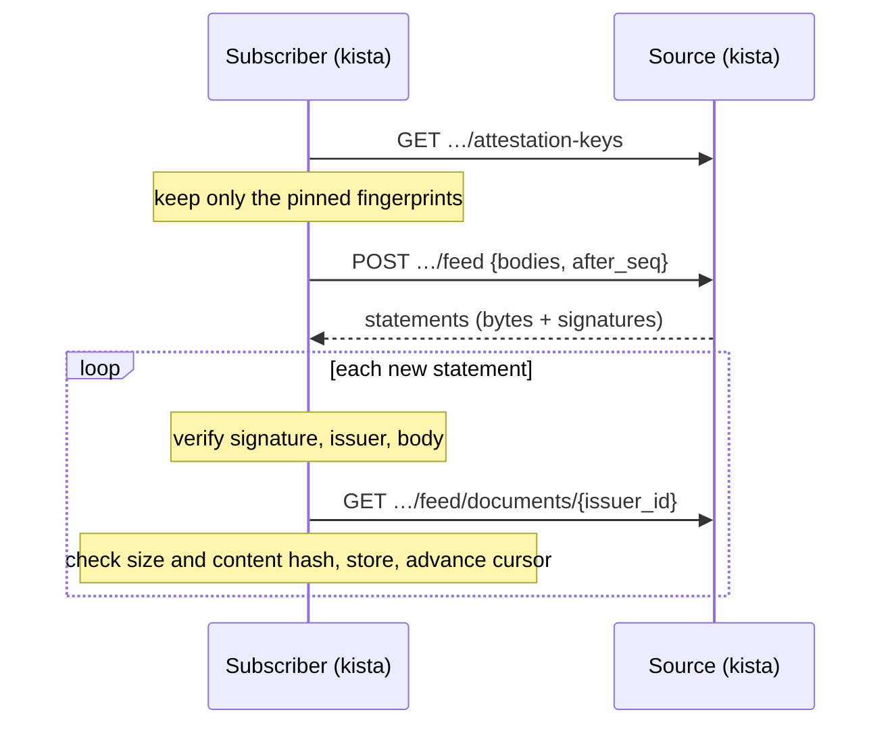

# Attachments and the feed

An **attachment** is a document about one extension binary: an SBOM, a vulnerability report, a
review, a provenance attestation, or notes. It is bound to the binary's body hash (the file without
its last 256 bytes, as `kista ext inspect` prints it), so it never applies to another build, and it
belongs to the tenant that holds the binary.

Documents come from three places:

- the tenant's administrators (origin `tenant`);
- a publisher's CI, next to its build (origin `publisher`, SBOMs and provenance only);
- another repository's **feed** (origin `feed`): signed statements about the bodies the tenant
  holds, pulled on a schedule and verified against keys the tenant pinned.

The design reasoning is in
[spec 0011](https://github.com/hugr-lab/duckdb-extension-repository/blob/main/specs/0011-attachments/spec.md).

## Documents

### Bound to a body

An attachment names a body hash, not a release. Every release of that body in the tenant shows it,
so a promotion carries its documents along. Only a body the tenant holds can take one: the
extension named in the path must have a build of that body. When the tenant stops holding the body
(its last build is collected, see [Storage](storage.md)), the collector removes its attachments
too, unless the body is blocked: the report that justified a block stays with the block.

### Kinds and media types

The list is closed. A document must parse as its media type says; kista computes a summary from it
once, at intake, and the summary is what lists, the index and the console show. A document whose
summary cannot be computed is refused with `400`.

| Kind | Media types | Summary |
| --- | --- | --- |
| `sbom` | `application/vnd.cyclonedx+json` (CycloneDX JSON), `application/spdx+json` (SPDX 2.x JSON) | components, licences, crypto assets |
| `vulnerabilities` | `application/vnd.cyclonedx+json` (VDR or VEX), `application/openvex+json`, `application/sarif+json`, `application/json; profile=osv-scanner` | findings by severity, not-affected count, `scanned_at` |
| `review` | `application/vnd.kista.review.v1+json` | verdict, `analysed_at`, analyser |
| `provenance` | `application/vnd.dev.sigstore.bundle.v0.3+json`, `application/vnd.dsse.envelope.v1+json` | predicate type, builder, source repository and ref, as claimed (not verified) |
| `notes` | `text/markdown` (UTF-8) | first line |

JSON documents are limited to 32 levels of nesting. A summary is at most 4,000 bytes. A title is 1
to 200 bytes of printable UTF-8.

A provenance document's subject is the file CI built, last 256 bytes included; kista binds to the
body hash and re-signs, so the attestation's subject digest is not the body hash. kista shows what
the attestation claims and does not verify it against the uploaded file yet.

### The review format

`review` documents use kista's open schema, `kista.review.v1`. Unknown fields are refused.

```json title="review.json"
{
  "schema": "kista.review.v1",
  "verdict": "approved",
  "analysed_at": "2026-10-01T12:00:00Z",
  "analyser": "Example Review Service",
  "capabilities": ["reads files"],
  "network": [],
  "files": ["$HOME/.duckdb"],
  "processes": [],
  "licences": ["MIT"],
  "findings": [{"severity": "low", "title": "…", "detail": "…"}],
  "text": "Markdown text"
}
```

- `verdict` is `approved`, `conditional` or `rejected`; `analysed_at` is RFC 3339; `analyser` is 1
  to 200 bytes.
- `capabilities`, `network`, `files`, `processes` and `licences` each hold at most 1,000 entries of
  at most 400 bytes; a finding's title is at most 400 bytes and its detail 8,000; `text` is at most
  1 MiB.

### Visibility

Every document starts as `administrators`. A tenant administrator may make it `readers`, one
document at a time. A `readers` document is shown, through the index, to whoever may see a release
of the body in the channel asked about: anyone, for a public release. Readers never see who attached
a document or what it supersedes. A feed's document shows its verified source (`issuer`) to readers.

### Versions and validity

A document may name an earlier one of the same body, kind, origin and issuer in `supersedes`,
forming a chain. A publisher supersedes only its own documents, and a publisher's document never
supersedes a tenant's or the reverse.

- Readers see only the head of a chain, and only if it is `readers` and not withdrawn. They never
  see an older version in its place.
- Administrators see the whole chain; list rows carry `head`.
- Removing a document links its successor to its predecessor; removing a head makes its predecessor
  the head again.
- A document past its `valid_until` is shown as `expired`. Only feed documents carry a
  `valid_until` (from the source's signed statement); the API and CLI do not set one.
- A version superseded more than a year ago is removed by the storage collector.

### Limits

| Limit | Value |
| --- | --- |
| Document size | 4 MiB, `attachments.max_size` (64 KiB to 16 MiB) |
| Chain heads per (body, kind, origin) | 20 (feed documents count per issuer) |
| Documents per tenant | 100,000 of its own, and 100,000 from feeds |
| Documents held in memory while read and sent | `attachments.max_reads` (default 8) |

Attaching over the API takes an upload slot, as publishing does.

### Who attaches and removes

- A tenant administrator, or an administrator of the extension (or of an extension group that
  includes it) whose grant has no channel: any kind, origin `tenant`.
- A principal or publisher holding `publish` on the extension with no channel scope: `sbom` and
  `provenance` only, origin `publisher`, and only for a body that one of its own publications
  released in the tenant.
- Feed documents are written by the feed client only.
- Removing: a tenant administrator, or the extension's administrator with no channel scope.
  Removing a feed document leaves a tombstone, so the feed does not bring it back.
- Making a document `readers`, `administrators`, feedable or unfeedable: tenant administrators.

A channel-scoped grant neither attaches nor removes: an attachment shows in every channel.

## Managing documents

### CLI

```bash
kista admin -config kista.yaml attachment add acme httpfs sbom.cdx.json \
  -body-hash <hash> -kind sbom -media-type application/vnd.cyclonedx+json -title "SBOM 1.2.0"
kista admin -config kista.yaml attachment list acme httpfs [-body-hash <hash>]
kista admin -config kista.yaml attachment show acme httpfs <id> [-content]
kista admin -config kista.yaml attachment readers|administrators acme httpfs <id>
kista admin -config kista.yaml attachment feedable|unfeedable acme httpfs <id>
kista admin -config kista.yaml attachment remove acme httpfs <id>
```

`add` reads the document from a file, or from stdin with `-`. `-body-hash`, `-kind`, `-media-type`
and `-title` are required; `-supersedes <id>` makes it a new version. It prints the new document's
id. The CLI acts as the server, so its documents have
origin `tenant`.

### API

Management routes take a fresh token (see [API](api.md)). The document is the raw request body:

```bash
curl -X POST "https://repo.example.com/api/v1/tenants/acme/extensions/httpfs/attachments?body_hash=<hash>&kind=sbom" \
  -H "Authorization: Bearer $TOKEN" \
  -H "Content-Type: application/vnd.cyclonedx+json" \
  -H "Kista-Title: SBOM%201.2.0" \
  --data-binary @sbom.cdx.json
```

- Query parameters: `body_hash`, `kind`, and optionally `supersedes`, each once.
- `Content-Type` is the media type; `Content-Length` is required.
- `Kista-Title` is the title, percent-encoded UTF-8.
- The answer is `201` with `Location` and the record's ETag (`"v<version>"`).

| Route | Who |
| --- | --- |
| `GET /api/v1/tenants/{t}/extensions/{ext}/attachments[?body_hash=&kind=&origin=&cursor=&limit=]` | the extension's administrators, the tenant's auditors |
| `GET …/extensions/{ext}/attachments/{id}` | the same: the record, with its ETag |
| `GET …/extensions/{ext}/attachments/{id}/content` | the same: the document, as a download |
| `POST …/extensions/{ext}/attachments?body_hash=&kind=[&supersedes=]` | administrators; publishers' credentials too |
| `POST …/extensions/{ext}/attachments/{id}/readers`, `/administrators`, `/feedable`, `/unfeedable` (`If-Match`) | tenant administrators |
| `DELETE …/extensions/{ext}/attachments/{id}` | tenant administrators, the extension's administrators |
| `GET /api/v1/tenants/{t}/blocks/{hash}/attachments`, `DELETE …/attachments/{id}` | tenant administrators: the documents of a blocked body whose builds are gone |

Readers read through the index, in their view of a channel:

| Route | Answer |
| --- | --- |
| `GET /api/v1/tenants/{t}/channels/{c}/extensions/{name}/attachments[?body_hash=&kind=&cursor=&limit=]` | the `readers` heads of the extension's bodies that the caller may see in `{c}` |
| `GET …/channels/{c}/extensions/{name}/attachments/{id}` | one of those, as a download |

The index's extension and version rows (`…/extensions/{name}`, `…/versions/{v}`) carry
`attachments`: per kind, the count, the latest summary the caller may read, and `expired`. The paged
`extensions` list does not.

Downloads are served with:

- the stored media type;
- `Content-Disposition: attachment; filename="<id>.json"` (or `.md`), never the title;
- `X-Content-Type-Options: nosniff` and `Content-Security-Policy: sandbox`;
- `Cache-Control: private, no-store`.

Every read checks the content against its recorded SHA-256 before sending anything.

### Console

The extension and release pages show a **Reports** block: kind, title, origin, date, expiry and
summary of each document. Administrators download and remove documents there, and attach one from
a release's page; tenant administrators also mark a document `readers` or feedable. See
[Console](console.md).

## Attestation keys

A tenant that offers documents to subscribers signs them with an **attestation key**: RSA-2048, held
in the same key sources as channel keys (see [Signing keys](signing-keys.md)), with its own registry
rows. One key never serves both roles.

- In Azure Key Vault and AWS KMS the key must carry the tag `kista-purpose`, and in Google Cloud
  KMS the label `kista-purpose`, with the value `attestation-signing`; a channel key carries
  `channel-signing`.
- File keys and Vault/OpenBao Transit keys have no tags: the fingerprint registry alone keeps the
  roles apart.

### Lifecycle

The lifecycle is a channel key's: `trusted`, `active`, `retired`, one active key per tenant, at most
16 keys that are not retired.

1. A server administrator registers a key by its signer reference. kista opens it, checks it and
   signs a probe. It is added as `trusted`, or `active` (`-active`) only for a tenant that never
   had an attestation key.
2. A tenant administrator activates a trusted key once it has been trusted for
   `rotation.min_trusted`; the previous active key becomes trusted.
3. A tenant administrator retires a trusted key once it has been in the trusted state for
   `rotation.min_demoted`. The active key cannot be retired: activate another first.

A server administrator may skip the minimums with `-force` (`?force=true` on the API).

```bash
kista admin -config kista.yaml attestation-key add acme vault-prod:acme-attest
kista admin -config kista.yaml attestation-key list acme
kista admin -config kista.yaml attestation-key activate acme sha256:<fingerprint>
kista admin -config kista.yaml attestation-key retire acme <id> [-force]
```

| Route | Who |
| --- | --- |
| `GET /api/v1/tenants/{t}/attestation-keys` | public: every key with its state and PEM public key |
| `POST /api/v1/tenants/{t}/attestation-keys {signer_ref, active}` | server administrators |
| `GET …/attestation-keys/{id}` | tenant administrators: the key with its ETag |
| `POST …/attestation-keys/{id}/activate`, `/retire` (`If-Match`; `?force=true` for server administrators) | tenant administrators |

The public list includes retired keys: statements they signed are still served, and a subscriber
that pinned one still verifies them. A subscriber stops trusting a key by unpinning it.

**Rotation**: add a new key, let subscribers pin its fingerprint, then activate it. Statements
signed after the switch fail to verify for a subscriber that has not pinned the new key; its cursor
waits and the statements are taken once the key is pinned.

## Signed statements

A **statement** is what a source says about one document. It is a JSON object canonicalised by RFC
8785 (JCS) and signed with RSA PKCS#1 v1.5 over SHA-256 of the domain separator
`kista-statement-v1\0` followed by the canonical bytes. It travels as its exact bytes (base64) with
the signature (base64); a subscriber verifies the bytes it received and never re-encodes them. A
statement is at most 16 KiB.

| Field | Meaning |
| --- | --- |
| `issuer` | the source tenant's URL, `<serve.public_url>/api/v1/tenants/<t>` with a lowercase host and no default port: a stable identity across key rotations |
| `key` | the signing key's fingerprint |
| `issuer_id` | the document's id at the source |
| `seq` | the statement's number, increasing per issuer |
| `body_hash` | the binary the document is about |
| `kind`, `media_type`, `content_hash`, `size`, `title`, `summary` | the document |
| `issued_at`, `valid_until` | RFC 3339 |
| `supersedes` | the `issuer_id` of an earlier document of the same issuer, body and kind |
| `origin` | who stands behind it at the source: `tenant` or `publisher:<name>` |
| `audience` | `administrators`, or `readers` when the source shows the document to its own readers |
| `withdrawn` | `true` for a withdrawal, which carries the document's identity only |

The subscriber refuses bytes that are not the canonical form and unknown fields. It does not store
the received `summary`: it computes its own from the content, which `content_hash` binds.

## Offering documents to the feed

A tenant serves a feed when it has an active attestation key and the deployment has
`serve.public_url` set. Only documents an administrator marks **feedable** are offered, and only the
tenant's own and its publishers' documents: documents received from a feed are not relayed.

- Marking a document feedable issues a statement (numbered and signed when the change commits). It
  fails while the tenant cannot sign.
- Changing the visibility of an offered document issues a new statement with the new `audience`.
- Marking it unfeedable, or removing it, issues a withdrawal. If the tenant cannot sign at all (no
  active key, no `serve.public_url`), the change goes ahead unsigned: the document is no longer
  offered, and subscribers that hold it keep it. A signer that fails makes the change fail, to be
  tried again.

```bash
kista admin -config kista.yaml attachment feedable acme httpfs <id>
```

### Granting the feed

A subscriber reads the feed with a token whose principal holds the verb `feed` at the source:

- on the tenant (every channel), or on a channel;
- a tenant-wide `admin` implies it; a channel's `admin` does not; it is never given to an
  issuer-wide principal or to a publisher.

```bash
kista admin -config kista.yaml grant add acme -principal 'client:corp-idp|kista-feed-bigcorp' -verb feed -channel stable
```

The source answers only for bodies released in the channels the grant covers. A body it does not
hold, or holds elsewhere, answers like one without documents. See [Access](access.md) for
principals and grants.

### The feed routes

```text
POST /api/v1/tenants/{t}/feed                    {"bodies": [{"body_hash": "…", "after_seq": 0}]}
GET  /api/v1/tenants/{t}/feed/documents/{issuer_id}
```

- A request names at most 500 bodies. The answer carries `statements` (never content), at most 1
  MiB, each body's in `seq` order, with `more` when it stopped early, and `bodies`: per body read,
  the last `seq` read.
- The answer leaves out an offer the source no longer makes and always carries withdrawals.
- Content is fetched by issuer id from the fixed path, with the same feedable and channel checks.
- These are not management routes: a feed credential may be long-lived. A principal without `feed`
  gets `404`.

## Subscribing to a feed

A **feed** on the subscriber's side is a subscription of one tenant to another repository's feed.
A replica's feed runner polls every 30 seconds and runs each feed that is due or requested, one
replica per feed at a time (under a lease).



### Prerequisites

1. **A credential.** The token comes from a credential configured under `upstreams.credentials`
   (see [Upstreams](upstreams.md)). Its `tenants` must include the subscribing tenant and its
   `prefixes` must cover the feed URL. Its principal holds `feed` at the source.
2. **Egress.** The source's address and port must be reachable through egress (see
   [Configuration](configuration.md)). Requests go without redirects, and the credential is sent
   only to the feed URL.
3. **Pinned keys.** The fingerprints (`sha256:<64 hex>`) of the source's attestation keys, read from
   `GET <feed URL>/attestation-keys` and checked with the source's operator.

### Adding a feed

```bash
kista admin -config kista.yaml feed add bigcorp enterest \
  -url https://enterest.example.com/api/v1/tenants/reviews \
  -credential enterest-feed \
  -key sha256:<fingerprint> \
  -kinds review,vulnerabilities
```

| Setting | Flag / JSON field | Meaning |
| --- | --- | --- |
| Name | positional / `name` | the feed's name in the tenant |
| Source URL | `-url` / `url` | `https://<host>[:port][/<path>]/api/v1/tenants/<t>`; no user info, query or fragment; normalised to a lowercase host without `:443`. It must equal the statements' `issuer` |
| Credential | `-credential` / `credential` | a configured credential's name (required) |
| Pinned keys | `-key` / `keys` | attestation key fingerprints, comma-separated |
| Kinds | `-kinds` / `kinds` | the kinds accepted; none: every kind |
| Readers | `-readers` / `readers` | allow documents whose signed `audience` is `readers` to arrive as `readers` |
| Offer | `-channels` / `offer`, `channels` | which body hashes are sent to the source (below) |
| Mode | `-mode` / `mode` | `online` (the default) or `bundle`: for statements in bundles ([Feeds for air-gapped sites](#feeds-for-air-gapped-sites)); set at creation |
| Export | `-export` / `export` | an online feed keeps what a bundle needs ([Feeds for air-gapped sites](#feeds-for-air-gapped-sites)) |

**Offer.** By default (`offer: upstreams`) the subscriber sends only the bodies it released from
upstreams, never ones it published itself. With `-channels a,b` (`offer: channels`) it sends the
bodies released in those channels. The source learns every body hash offered: the default keeps the
tenant's own builds out of it.

**Readers.** Documents arrive as `administrators`. With `readers` on, a document whose signed
`audience` is `readers` arrives as `readers`, shown to anyone who may see a release of the body. Turn
it on only when the source allows republishing: a paid review shown to readers of a public release
is published to anyone.

### Operating a feed

```bash
kista admin -config kista.yaml feed list bigcorp
kista admin -config kista.yaml feed show bigcorp enterest
kista admin -config kista.yaml feed sync bigcorp enterest      # a running kista serve takes the run
kista admin -config kista.yaml feed pause|resume bigcorp enterest
kista admin -config kista.yaml feed set bigcorp enterest -key sha256:<a>,sha256:<b> -kinds - -readers=false
kista admin -config kista.yaml feed remove bigcorp enterest [-documents]
```

`set` changes the credential, pinned keys, kinds (`-` clears them: every kind), readers and
export (`-export=true|false`). The source URL, the offer and the mode cannot change; remove and add
the feed instead.

| Route | Who |
| --- | --- |
| `GET, POST /api/v1/tenants/{t}/feeds` | tenant administrators |
| `GET …/feeds/{name}` | tenant administrators: the feed with its ETag |
| `POST …/feeds/{name}` `{state, credential, kinds, readers, keys, export}` (`If-Match`) | tenant administrators: each field given is changed; `state` is `active` or `paused`; `mode` cannot change (`400`) |
| `DELETE …/feeds/{name}[?documents=true]` (`If-Match`) | tenant administrators |
| `POST …/feeds/{name}/sync` | tenant administrators: requests a run (`202`); refused while the feed is paused, and for a bundle-mode feed (`409`) |

Adding an online feed and resuming one request a run. Otherwise a feed runs every
`attachments.feed_interval` (default 6 h, at least 5 min) with up to 10% jitter, and 5 minutes after
a failing run.

**Removing** a feed keeps its documents unless `-documents` (`?documents=true`) is given. Then they
pass to another feed of the same source if there is one, and otherwise are removed.

### Statuses

| Status | Meaning |
| --- | --- |
| `new` | never run; for a bundle-mode feed, no bundle imported yet |
| `ok` | the last run completed |
| `unauthorized` | the source answered the feed request with `404` (the credential's principal does not hold `feed`, or there is no such tenant), or refused the token twice; the next run is at the normal interval |
| `failing` | the last run failed (network, egress, credential, none of the pinned keys published, an export feed at its cap, …); retried after 5 minutes |

A feed's state is `active` or `paused`. `feed show` and the API give the last error, the last
success, the next run, whether a run is requested, and the last run's result: counts (`offered`,
`received`, `superseded`, `withdrawn`, `updated`, `duplicate`, `failed`, `refused`; for an export
feed also `kept`, statements about documents not held, `held`, statements waiting at the cap, and
`overtaken`, a run stopped by a change of `export`) and up to 20 refusals with their reasons.

### How a subscriber verifies

For each run:

1. It reads the source's published attestation keys and keeps only the pinned ones. If none of the
   pinned keys is published, the run fails.
2. It sends its offered bodies, each with the last `seq` it received; a body never sent goes with
   `0` and receives its whole history.
3. For each statement it checks the signature against a pinned key, that `issuer` equals the feed
   URL, and that the body is one it sent and still holds.
4. It fetches the content from the fixed path and checks its size and SHA-256 against the
   statement.
5. A `supersedes` must name an earlier statement of the same issuer, body and kind. One the
   subscriber never received, or removed, is kept as an unresolved link.
6. A withdrawal marks its target as withdrawn.

Cursors are per (feed, body):

- **Stored, or refused for good**: the cursor moves past the statement, and a refusal is recorded
  with its reason: `kind` (not accepted by the feed), `media type`, `title`, `size`, `content` (does
  not match the statement), `document` (does not parse as its media type), `changed` (a held
  document's content or body differs), `body` (a withdrawal for another body), `not held`,
  `limits`, `unrequested` (a body the subscriber did not send). A document another feed stored first
  counts as `duplicate`, not as a refusal.
- **A transient failure** (a fetch, egress, a document the source no longer serves): the cursor
  stays, and the body's later statements wait for the next run.
- **Not verified** (`encoding`, `signature`: an unpinned key or bad bytes, `issuer`: another
  issuer): the body's cursor is held, so the statement is tried again at the next run and taken once
  its key is pinned.

A newer statement about a document already held updates its statement and validity. Its visibility
only narrows (to `administrators` when the audience does); its content, kind and body never change.
The same document reaching the tenant through two feeds is stored once.

Each run records a `feed.run` event (see [Observability](observability.md)).

## Feeds for air-gapped sites

An air-gapped site will take statements in bundles, as it takes extension files
([Bundle mode](upstreams.md#bundle-mode), spec 0014 phase 1b). This version has the two kinds of
feed the bundles need. A plan lists the site's bundle-mode feeds, with the bodies each offers and
the last statement received. An export carries the statements an export feed holds
([Exporting a bundle](upstreams.md#exporting-a-bundle)). Imports do not take statements yet: until
they do, a bundle-mode feed receives nothing.

**A bundle-mode feed** (`-mode bundle`, `"mode": "bundle"`), at the site:

- its URL is only the identity its statements name: it must be https, but kista never contacts it,
  so egress need not reach it, and it takes no credential (`400`);
- it never runs: it is not scheduled, adding or resuming it requests no run, and `sync` answers
  `409`;
- its status stays `new`; its record will show the last bundle imported (`bundle_id`,
  `bundle_created_at`);
- its pinned keys, kinds, readers and offer are set as an online feed's: they decide what the site
  asks for in a plan, and will decide what it takes in.

**An export feed** (`-export`, `"export": true`), on a gateway: an online feed that also keeps what a
bundle needs to answer a site's plan.

- **The keys file**: the source's `GET …/attestation-keys` answer, kept by each run that verified
  it (`keys_file_at` in the record). A file over 64 KiB, or not UTF-8, fails the run (`failing`).
- **Its refusals for good**, each with the statement's signed bytes: the reasons above, except
  `unrequested`. They still count under `refused` in a run. The site will judge each statement
  again itself.
- **Statements about documents the tenant does not hold**: a withdrawal of a document never stored,
  and any statement about one removed here (by an administrator, or by the collector after it was
  superseded for a year). A site may hold the document. A run counts them as `kept`. When the
  document arrives later through another feed of the source, a kept withdrawal of it applies if
  that feed pins the key that signed it.

**Changing it.** Setting `export` (`-export=true`) resets the feed's cursors and, on an active feed,
requests a run: it reads the whole history again and keeps what it refused before. Clearing it
(`-export=false`), or removing the feed, deletes its refusals and keys file; the kept statements of a
source go when no feed of its URL has `export` left. A run that the change overtakes stops and
writes nothing (`overtaken`). The collector deletes a body's refusals and kept statements with its
cursors.

**A cap of its own.** A tenant's export feeds keep at most 100,000 refusals and statements together,
apart from the quota of feed documents, so a source never costs another source a document. Past the
cap, a statement an export feed cannot keep holds its body's cursor (`held` in the run), the other
bodies go on, and the run ends `failing` (`limits`): nothing is passed over unseen. Room comes back
as the collector removes bodies no longer held, or when `export` is cleared on a feed.

## Configuration

```yaml title="kista.yaml"
attachments:            # file-only
  max_size: 4194304     # bytes (4 MiB); 65536..16777216
  max_reads: 8          # documents held in memory at once while read and sent; 0..256
  feed_interval: 6h     # between a feed's scheduled runs; at least 5m
```

| Setting | Default | Range |
| --- | --- | --- |
| `attachments.max_size` | 4 MiB | bytes, 64 KiB to 16 MiB (0: the default) |
| `attachments.max_reads` | 8 | 1 to 256 (0: the default) |
| `attachments.feed_interval` | 6h | at least 5m |

The block is file-only: there are no `KISTA_ATTACHMENTS_*` variables. Statements also need
`serve.public_url`. See [Configuration](configuration.md).

## Events

| Kind | Subject | When |
| --- | --- | --- |
| `attachment.add`, `attachment.change`, `attachment.remove` | `ext:<name>/attachment:<id>`; `block:<body hash>/attachment:<id>` for a removal through a block | a document attached, its visibility or feedable flag changed, removed; on a change or removal, `statement` is the seq issued with it |
| `attestation_key.add`, `.activate`, `.retire` | `attestation-key:<id>` | the key lifecycle |
| `feed.add`, `feed.change`, `feed.remove` | `feed:<name>` | a subscription changed; `feed.add` gives its `mode` and `export`; a change of `export` records `cursors: reset` or `kept: dropped` |
| `feed.run` | `feed:<name>` | a run's counts, refusals by reason, and an error class |

A source does not record one event per feed request; refusals are `authz.refused`.
