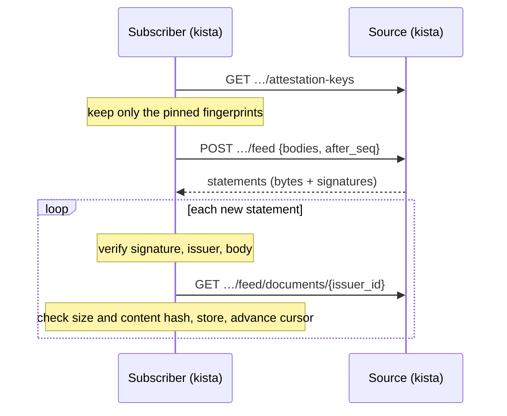

# Attachments and the feed

An **attachment** is a document about one extension binary: an SBOM, a vulnerability report, a
review, a provenance attestation, or notes. It is bound to the binary's body hash (the file without
its last 256 bytes, as `kista ext inspect` prints it), so it never applies to another build, and it
belongs to the tenant that holds the binary.

Documents come from three places:

- the tenant's administrators (origin `tenant`);
- a publisher's CI, next to its build (origin `publisher`, SBOMs and provenance only);
- another repository's **feed** (origin `feed`): signed statements about the bodies the tenant
  holds, pulled on a schedule and verified against keys the tenant pinned.

The design reasoning is in
[spec 0011](https://github.com/hugr-lab/duckdb-extension-repository/blob/main/specs/0011-attachments/spec.md).

## Documents

### Bound to a body

An attachment names a body hash, not a release. Every release of that body in the tenant shows it,
so a promotion carries its documents along. Only a body the tenant holds can take one: the
extension named in the path must have a build of that body. When the tenant stops holding the body
(its last build is collected, see [Storage](storage.md)), the collector removes its attachments
too, unless the body is blocked: the report that justified a block stays with the block.

### Kinds and media types

The list is closed (the code's: six kinds). A document must parse as its media type says; kista computes a summary from it
once, at intake, and the summary is what lists, the index and the console show. A document whose
summary cannot be computed is refused with `400`.

| Kind | Media types | Summary |
| --- | --- | --- |
| `sbom` | `application/vnd.cyclonedx+json` (CycloneDX JSON), `application/spdx+json` (SPDX 2.x JSON) | components, licences, crypto assets |
| `vulnerabilities` | `application/vnd.cyclonedx+json` (VDR or VEX), `application/openvex+json`, `application/sarif+json`, `application/json; profile=osv-scanner` | findings by severity, `informational` and not-affected counts, `scanned_at`; for CycloneDX also `components`, `checked`, `not_checked` ([below](#vulnerabilities-summaries)) |
| `review` | `application/vnd.kista.review.v1+json` | verdict, `analysed_at`, analyser |
| `provenance` | `application/vnd.dev.sigstore.bundle.v0.3+json`, `application/vnd.dsse.envelope.v1+json` | predicate type, builder, source repository and ref, as claimed (not verified) |
| `notes` | `text/markdown` (UTF-8) | first line |
| `report` | `application/vnd.kista.report+json` ([below](#the-report-format)) | the report's id, issue, date, depth, points of attention, sections, the number of bodies and whether this one was read |

JSON documents are limited to 32 levels of nesting. A summary is at most 4,000 bytes. A title is 1
to 200 bytes of printable UTF-8.

A provenance document's subject is the file CI built, last 256 bytes included; kista binds to the
body hash and re-signs, so the attestation's subject digest is not the body hash. kista shows what
the attestation claims and does not verify it against the uploaded file yet.

### The review format

`review` documents use kista's open schema, `kista.review.v1`. Unknown fields are refused when a
document is attached here (a typo must fail); a review received from a feed or a bundle may carry
fields a later analyser added, which are ignored ([Compatibility](compatibility.md)).

```json title="review.json"
{
  "schema": "kista.review.v1",
  "verdict": "approved",
  "analysed_at": "2026-10-01T12:00:00Z",
  "analyser": "Example Review Service",
  "capabilities": ["reads files"],
  "network": [],
  "files": ["$HOME/.duckdb"],
  "processes": [],
  "licences": ["MIT"],
  "findings": [{"severity": "low", "title": "…", "detail": "…"}],
  "text": "Markdown text"
}
```

- `verdict` is `approved`, `conditional` or `rejected`; `analysed_at` is RFC 3339; `analyser` is 1
  to 200 bytes.
- `capabilities`, `network`, `files`, `processes` and `licences` each hold at most 1,000 entries of
  at most 400 bytes; a finding's title is at most 400 bytes and its detail 8,000; `text` is at most
  1 MiB.

### The report format

A `report` is what an analyser found in a build, in the analyser's own words: one JSON object with a
few summary members kista reads and the issuer's page, `html`, which kista never parses. It carries
no verdict and kista computes none ([spec 0045](https://github.com/hugr-lab/duckdb-extension-repository/blob/main/specs/0045-received-reports/spec.md)).

```json title="report.json"
{
  "envelope": "kista.report.v1",
  "report": "rep-2026-0042",
  "issue": 2,
  "issued_at": "2026-11-16T10:00:00Z",
  "depth": "static",
  "subject": {"bodies": [{"hash": "<64 hex>", "read": true}]},
  "attention": [{"kind": "network", "count": 3}],
  "kinds_evaluated": 12,
  "sections": [{"name": "imports", "status": "analysed"}],
  "html": "<h1>…</h1><p>…</p>"
}
```

| Member | Type and bound | Read for |
| --- | --- | --- |
| `envelope` | `kista.report.v<N>`, N 1 to 2^31 | the version, shown |
| `report` | 1 to 128 bytes of `[A-Za-z0-9._:-]` | the report's id at its issuer |
| `issue` | integer, 0 to 2^31 | shown; sorts heads a producer did not chain |
| `issued_at` | RFC 3339 | shown |
| `depth` | 1 to 32 bytes of `[a-z0-9_.-]` | how far the analysis went |
| `subject.bodies` | 1 to 1,000 of `{hash: 64 lowercase hex, read: boolean}` | the body attached to must be listed; whether it was read |
| `attention` | at most 32 of `{kind: 1 to 32 bytes of [a-z0-9_.-], count: 0 to 2^31}` | points of attention by kind |
| `kinds_evaluated` | integer, 0 to 2^31, optional | "none" differs from "not evaluated" |
| `sections` | at most 16 of `{name, status}`, each 1 to 32 bytes of `[a-z0-9_.-]`, optional | coverage |
| `html` | string | the issuer's page |

- **These members are the kind's floor, frozen for every envelope version.** kista reads nothing else
  and interprets no version: a report of a later envelope is stored and shown exactly as `v1` is, and
  never waits for an upgrade ([Compatibility](compatibility.md)).
- **Strict members**: `envelope`, `report`, `issue`, `issued_at`, `depth`, `subject.bodies` and
  `html`. A document that breaks one is refused (`400` at an attach, the refusal `document` at a
  feed or a bundle), and so is one whose `subject.bodies` does not list the body it is attached to.
- **Everything else is carried unread.** Members are read by exact name; a document that repeats a
  read member, in any letter case, is refused, and so is one that holds a second JSON value after
  the object. Integers are written without a fraction or exponent.
- **A summary list that breaks its rule does not lose the report.** An `attention` or `sections`
  entry outside its grammar or bounds, or a `kinds_evaluated` that is not such an integer, drops
  that member from the summary and sets `incomplete`; so does one of the three spelled only in
  another letter case (`Attention` without `attention`), which is not read; the console's row then says "summary
  incomplete: open the report".
- **`html`** is semantic HTML only: headings, paragraphs, lists, tables, code, `details`; no style,
  no script, no external resource. kista checks only that it is a string; its size is the
  document's, within `attachments.max_size`. The console shows it in an isolated frame under kista's
  own stylesheet ([Console](console.md#a-reports-page)); the API serves a report as any document,
  as a file of its own type, never as `text/html`.
- **The summary** is those members without `html`, with `bodies` (their number) and `read` (this
  body's) in place of `subject`.

**Issues.** A report's issues are a chain: each issue `supersedes` the previous issue's document of
the same body, and the head is what is shown. A source retracts a report with a **higher issue** (a
correction), never by withdrawing the highest alone: a kista that first receives a body's documents
after the highest issue was withdrawn sees the lower one as current.

### Vulnerabilities summaries

- `info` and `none` are `informational`: counted apart, outside `findings`. A vulnerability is
  informational only when every rating it carries is `info` or `none`; one that also has an
  unrated or unknown rating stays a finding.
- In a CycloneDX document a component is **checked** only when it carries the property
  `kista:vulnerabilities:check` exactly once with the value `checked`; one that carries it exactly
  once with `not_checked` is counted as marked not checked. The summary has `components` (all of
  them), `checked` and `not_checked`. A property of another shape (a value that is not a string)
  leaves its component unmarked; it does not refuse the document.
- The console never says "no findings" while a component is unchecked or unmarked, but "N of M
  components checked"; a count that reached the list bound (100,000) says "at least", and a
  document at that bound is never read as fully checked ("N of at least M components checked").
- Freshness is the statement's `valid_until`: the console's 30-day flag shows only on a document
  without an unexpired one.

A producer whose own marks differ maps them onto these; the mapping is the source's job.

### Visibility

Every document starts as `administrators`. A tenant administrator may make it `readers`, one
document at a time. A `readers` document is shown, through the index, to whoever may see a release
of the body in the channel asked about: anyone, for a public release. Readers never see who attached
a document or what it supersedes. A feed's document shows its verified source (`issuer`) to readers.

### Versions and validity

A document may name an earlier one of the same body, kind, origin and issuer in `supersedes`,
forming a chain. A publisher supersedes only its own documents, and a publisher's document never
supersedes a tenant's or the reverse.

- Readers see only the head of a chain, and only if it is `readers` and not withdrawn. They never
  see an older version in its place.
- Administrators see the whole chain; list rows carry `head`.
- Removing a document links its successor to its predecessor; removing a head makes its predecessor
  the head again.
- A document past its `valid_until` is shown as `expired`. Only feed documents carry a
  `valid_until` (from the source's signed statement); the API and CLI do not set one.
- A version superseded more than a year ago is removed by the storage collector.

### Limits

| Limit | Value |
| --- | --- |
| Document size | 4 MiB, `attachments.max_size` (64 KiB to 16 MiB); a kista that takes reports usually sets it higher |
| Chain heads per (body, kind, origin) | 20 (feed documents count per issuer) |
| Documents per tenant | 100,000 of its own, and 100,000 from feeds |
| Documents held in memory while read and sent | `attachments.max_reads` (default 8) |

Attaching over the API takes an upload slot, as publishing does.

A feed run buffers each document whole, outside `attachments.max_reads`: memory is about `max_size`
× (`max_reads` + the feeds running at once), and more while a document is summarised. The quota
counts documents, not bytes. A feed's download has two minutes, so a 16 MiB document needs about
140 KiB/s.

### Who attaches and removes

- A tenant administrator, or an administrator of the extension (or of an extension group that
  includes it) whose grant has no channel: any kind, origin `tenant`.
- A principal or publisher holding `publish` on the extension with no channel scope: `sbom` and
  `provenance` only, origin `publisher`, and only for a body that one of its own publications
  released in the tenant.
- Feed documents are written by the feed client only.
- Removing: a tenant administrator, or the extension's administrator with no channel scope.
  Removing a feed document leaves a tombstone, so the feed does not bring it back.
- Making a document `readers`, `administrators`, feedable or unfeedable: tenant administrators.

A channel-scoped grant neither attaches nor removes: an attachment shows in every channel.

## Managing documents

### CLI

```bash
kista admin -config kista.yaml attachment add acme httpfs sbom.cdx.json \
  -body-hash <hash> -kind sbom -media-type application/vnd.cyclonedx+json -title "SBOM 1.2.0"
kista admin -config kista.yaml attachment list acme httpfs [-body-hash <hash>]
kista admin -config kista.yaml attachment show acme httpfs <id> [-content]
kista admin -config kista.yaml attachment readers|administrators acme httpfs <id>
kista admin -config kista.yaml attachment feedable|unfeedable acme httpfs <id>
kista admin -config kista.yaml attachment remove acme httpfs <id>
```

`add` reads the document from a file, or from stdin with `-`. `-body-hash`, `-kind`, `-media-type`
and `-title` are required; `-supersedes <id>` makes it a new version. It prints the new document's
id. The CLI acts as the server, so its documents have
origin `tenant`.

### API

Management routes take a fresh token (see [API](api.md)). The document is the raw request body:

```bash
curl -X POST "https://repo.example.com/api/v1/tenants/acme/extensions/httpfs/attachments?body_hash=<hash>&kind=sbom" \
  -H "Authorization: Bearer $TOKEN" \
  -H "Content-Type: application/vnd.cyclonedx+json" \
  -H "Kista-Title: SBOM%201.2.0" \
  --data-binary @sbom.cdx.json
```

- Query parameters: `body_hash`, `kind`, and optionally `supersedes`, each once.
- `Content-Type` is the media type; `Content-Length` is required.
- `Kista-Title` is the title, percent-encoded UTF-8.
- The answer is `201` with `Location` and the record's ETag (`"v<version>"`).

| Route | Who |
| --- | --- |
| `GET /api/v1/tenants/{t}/extensions/{ext}/attachments[?body_hash=&kind=&origin=&source=&version=&head=&cursor=&limit=]` | the extension's administrators, the tenant's auditors. `source` (`tenant`, `upstream:<name>`, `publisher:<name>`) and `version` narrow the list to the documents about that source's builds of that version; `head=true` to chain heads, withdrawn ones included (each says `withdrawn`): together, what is held about a version that waits for a decision |
| `GET …/extensions/{ext}/attachments/{id}` | the same: the record, with its ETag |
| `GET …/extensions/{ext}/attachments/{id}/content` | the same: the document, as a download |
| `POST …/extensions/{ext}/attachments?body_hash=&kind=[&supersedes=]` | administrators; publishers' credentials too |
| `POST …/extensions/{ext}/attachments/{id}/readers`, `/administrators`, `/feedable`, `/unfeedable` (`If-Match`) | tenant administrators |
| `DELETE …/extensions/{ext}/attachments/{id}` | tenant administrators, the extension's administrators |
| `GET /api/v1/tenants/{t}/blocks/{hash}/attachments`, `DELETE …/attachments/{id}` | tenant administrators: the documents of a blocked body whose builds are gone |

Readers read through the index, in their view of a channel:

| Route | Answer |
| --- | --- |
| `GET /api/v1/tenants/{t}/channels/{c}/extensions/{name}/attachments[?body_hash=&kind=&cursor=&limit=]` | the `readers` heads of the extension's bodies that the caller may see in `{c}` |
| `GET …/channels/{c}/extensions/{name}/attachments/{id}` | one of those, as a download |

The index's extension and version rows (`…/extensions/{name}`, `…/versions/{v}`) carry
`attachments`: per kind, the count, the latest summary the caller may read, and `expired`. The paged
`extensions` list does not.

Downloads are served with:

- the stored media type;
- `Content-Disposition: attachment; filename="<id>.json"` (or `.md`), never the title;
- `X-Content-Type-Options: nosniff` and `Content-Security-Policy: sandbox`;
- `Cache-Control: private, no-store`.

Every read checks the content against its recorded SHA-256 before sending anything.

### Console

The extension and release pages show a **Reports** block: kind, title, origin, date, expiry and
summary of each document. Administrators download and remove documents there, and attach one from
a release's page; tenant administrators also mark a document `readers` or feedable. See
[Console](console.md).

## Attestation keys

A tenant that offers documents to subscribers signs them with an **attestation key**: RSA-2048, held
in the same key sources as channel keys (see [Signing keys](signing-keys.md)), with its own registry
rows. One key never serves both roles.

- In Azure Key Vault and AWS KMS the key must carry the tag `kista-purpose`, and in Google Cloud
  KMS the label `kista-purpose`, with the value `attestation-signing`; a channel key carries
  `channel-signing`.
- File keys and Vault/OpenBao Transit keys have no tags: the fingerprint registry alone keeps the
  roles apart.

### Lifecycle

The lifecycle is a channel key's: `trusted`, `active`, `retired`, one active key per tenant, at most
16 keys that are not retired by default (`limits.ceilings.signing_keys`).

1. A server administrator registers a key by its signer reference. kista opens it, checks it and
   signs a probe. It is added as `trusted`, or `active` (`-active`) only for a tenant that never
   had an attestation key.
2. A tenant administrator activates a trusted key once it has been trusted for
   `rotation.min_trusted`; the previous active key becomes trusted.
3. A tenant administrator retires a trusted key once it has been in the trusted state for
   `rotation.min_demoted`. The active key cannot be retired: activate another first.

A server administrator may skip the minimums with `-force` (`?force=true` on the API).

```bash
kista admin -config kista.yaml attestation-key add acme vault-prod:acme-attest
kista admin -config kista.yaml attestation-key list acme
kista admin -config kista.yaml attestation-key activate acme sha256:<fingerprint>
kista admin -config kista.yaml attestation-key retire acme <id> [-force]
```

| Route | Who |
| --- | --- |
| `GET /api/v1/tenants/{t}/attestation-keys` | public: every key with its state and PEM public key |
| `POST /api/v1/tenants/{t}/attestation-keys {signer_ref, active}` | server administrators |
| `GET …/attestation-keys/{id}` | tenant administrators: the key with its ETag |
| `POST …/attestation-keys/{id}/activate`, `/retire` (`If-Match`; `?force=true` for server administrators) | tenant administrators |

The public list includes retired keys: statements they signed are still served, and a subscriber
that pinned one still verifies them. A subscriber stops trusting a key by unpinning it.

**Rotation**: add a new key, let subscribers pin its fingerprint, then activate it. Statements
signed after the switch fail to verify for a subscriber that has not pinned the new key; its cursor
waits and the statements are taken once the key is pinned.

## Signed statements

A **statement** is what a source says about one document. It is a JSON object canonicalised by RFC
8785 (JCS) and signed with RSA PKCS#1 v1.5 over SHA-256 of the domain separator
`kista-statement-v1\0` followed by the canonical bytes. It travels as its exact bytes (base64) with
the signature (base64); a subscriber verifies the bytes it received and never re-encodes them. A
statement is at most 16 KiB.

| Field | Meaning |
| --- | --- |
| `issuer` | the source tenant's URL, `<serve.public_url>/api/v1/tenants/<t>` with a lowercase host and no default port: a stable identity across key rotations |
| `key` | the signing key's fingerprint |
| `issuer_id` | the document's id at the source |
| `seq` | the statement's number, increasing per issuer |
| `body_hash` | the binary the document is about |
| `kind`, `media_type`, `content_hash`, `size`, `title`, `summary` | the document; `kind` is `[a-z][a-z0-9-]{0,15}` and `media_type` 1 to 200 bytes, in the canonical form of [Kinds and media types](#kinds-and-media-types) |
| `issued_at`, `valid_until` | RFC 3339 |
| `supersedes` | the `issuer_id` of an earlier document of the same issuer, body and kind |
| `origin` | who stands behind it at the source: `tenant` or `publisher:<name>`; a subscriber stores and shows any printable text of at most 80 bytes |
| `audience` | `administrators`, or `readers` when the source shows the document to its own readers; a subscriber reads anything but `readers` as not for readers |
| `withdrawn` | `true` for a withdrawal, which carries the document's identity only |
| `v` | the format's major; absent is 1, and this release writes none |

The subscriber refuses bytes that are not the canonical form. It ignores fields it does not know,
under the member-name rule: every field name at every depth is `[a-z0-9_]{1,64}` and none is twice
in its object, or the statement does not verify. It does not store the received `summary`: it
computes its own from the content, which `content_hash` binds. What it does with a statement of a
newer source is in [Compatibility](compatibility.md).

## Offering documents to the feed

A tenant serves a feed when it has an active attestation key and the deployment has
`serve.public_url` set. Only documents an administrator marks **feedable** are offered with the
tenant's own statements, and only the tenant's own and its publishers' documents. Documents received
from a feed are handed on another way, with their issuer's statements unchanged
([Handing received documents on](#handing-received-documents-on)).

- Marking a document feedable issues a statement (numbered and signed when the change commits). It
  fails while the tenant cannot sign.
- Changing the visibility of an offered document issues a new statement with the new `audience`.
- Marking it unfeedable, or removing it, issues a withdrawal. If the tenant cannot sign at all (no
  active key, no `serve.public_url`), the change goes ahead unsigned: the document is no longer
  offered, and subscribers that hold it keep it. A signer that fails makes the change fail, to be
  tried again.

```bash
kista admin -config kista.yaml attachment feedable acme httpfs <id>
```

### Granting the feed

A subscriber reads the feed with a token whose principal holds the verb `feed` at the source:

- on the tenant (every channel), or on a channel;
- a tenant-wide `admin` implies it; a channel's `admin` does not; it is never given to an
  issuer-wide principal or to a publisher.

```bash
kista admin -config kista.yaml grant add acme -principal 'client:corp-idp|kista-feed-bigcorp' -verb feed -channel stable
```

The source answers only for bodies released in the channels the grant covers. A body it does not
hold, or holds elsewhere, answers like one without documents. See [Access](access.md) for
principals and grants.

### The feed routes

```text
POST /api/v1/tenants/{t}/feed                    {"bodies": [{"body_hash": "…", "after_seq": 0}]}
GET  /api/v1/tenants/{t}/feed/documents/{issuer_id}
```

- A request names at most 500 bodies. The answer carries `statements` (never content), at most
  `attachments.feed_answer_max` bytes (1 MiB by default), each body's in `seq` order, with `more`
  when it stopped early, and `bodies`: per body read, the last `seq` read.
- With `issuer` in the request, and `?issuer=` on the content route, the routes answer for another
  issuer's documents the tenant hands on ([below](#handing-received-documents-on)); without it,
  only the tenant's own.
- The answer leaves out an offer the source no longer makes and always carries withdrawals.
- Content is fetched by issuer id from the fixed path, with the same feedable and channel checks.
- These are not management routes: a feed credential may be long-lived. A principal without `feed`
  gets `404`.

## Handing received documents on

A tenant hands a source's documents on when its feed of that source has **`export`** set: in a
bundle for an air-gapped site ([Feeds for air-gapped sites](#feeds-for-air-gapped-sites)) **and
online, to every holder of `feed`** on the tenant's channels, those who hold it already included.
This is how an organisation's own kista, which mirrors a channel of the organisation's tenant on
another kista, receives what an issuer said about the builds it mirrors without ever reaching the
issuer. The relaying tenant signs nothing: the issuer's statements pass unchanged, and the
downstream verifies them against the issuer's keys it pinned.

```text
POST /api/v1/tenants/{t}/feed  {"issuer": "<the issuer's feed URL>", "bodies": [{"body_hash": "…", "after_seq": 0}]}
                               →  {"keys": {…}, "statements": [{"statement", "signature", "note"?}], "bodies": […], "more": false}
GET  /api/v1/tenants/{t}/feed/documents/{issuer_id}?issuer=<url>   →  the content
```

- `issuer` is a feed URL in its normalised form (`https://<host>/api/v1/tenants/<t>`), else `400`.
- Authorised by `feed`, scoped to the grant's channels, as the tenant's own feed. A credential that
  only installs never gets it: grant `feed` on the mirrored channel beside `install`.
- Answered only for an issuer of which the tenant has an online feed with `export` set that kept a
  keys file. Any other issuer, and any body out of scope, answers as a body without documents (the
  content route: as a missing path).
- `keys` is the issuer's keys file as the relaying feed last fetched it. There is no keys route.
- Per body, from `after_seq` to the feed's cursor, in `seq` order: the stored statement bytes and
  signature of each document held from the issuer, withdrawals, and what the export feed keeps
  (refusals, statements that wait, statements about documents not held).
- Content is served only for documents of kinds an `export` feed of that issuer takes. Every other
  statement goes without content, with an unsigned `note`: for a statement the relay waits on, its
  waiting reason (`newer`, `unknown kind`, `media type`, `document version`); for the rest (removed
  or refused at the relay, or of a kind its export feed does not take) the fixed text
  `not held by the relay`.
- Each statement is verified against the relaying feed's own pinned keys before it is sent: a
  body's answer ends just below one that does not verify. The relaying feed's record then says so
  (`relay_stopped`, the number of bodies its last such answer ended early, and `relay_stopped_at`;
  a line in the console and in `feed show`), and the server logs it: its downstreams receive
  nothing past that statement until the key that signed it is pinned. A change of the feed's keys
  or of `export` clears the record.
- With several feeds of the issuer that hand on, a body is answered from the one that read
  furthest. A statement that feed refused for its `kinds` is not sent as "not held" while another
  of them takes the kind and has not read that far (one that has not run yet, or is paused,
  included): the body's answer ends just below it, until that feed has read it.
- An answer holds at most `attachments.feed_answer_max` bytes as written, the keys file included,
  then `more`. A keys file that leaves no room for a statement under that bound is not handed on
  (the answer carries no `keys`), and the server logs it.
- The answer is checked against a change made while it was read: a body whose feed's `export` or
  cursor changed meanwhile is answered nothing, and the subscriber asks again.
- A suspended tenant serves nothing on the feed routes: a downstream's feed turns `unauthorized`,
  keeps what it holds, and no withdrawal arrives meanwhile.

**What a holder of `feed` learns**: the documents of bodies released in its channels, and which
issuers the tenant hands on. A report lists the hashes of its subject's other bodies, and a
statement of a kind the export feed does not take still arrives with its signed title and summary.
Setting `export` widens what every existing holder receives; the console's confirmation says so.

**A relay can withhold.** What it omits is omitted for good: the downstream's cursor passes it. It
comes back only by resetting the feed's cursors (remove the feed keeping its documents, add it
again).

## Subscribing to a feed

A **feed** on the subscriber's side is a subscription of one tenant to another repository's feed.
A replica's feed runner polls every 30 seconds and runs each feed that is due or requested, one
replica per feed at a time (under a lease).



### Prerequisites

1. **A credential.** The token comes from a credential configured under `upstreams.credentials`
   (see [Upstreams](upstreams.md)). Its `tenants` must include the subscribing tenant and its
   `prefixes` must cover the feed URL. Its principal holds `feed` at the source.
2. **Egress.** The source's address and port must be reachable through egress (see
   [Configuration](configuration.md)). Requests go without redirects, and the credential is sent
   only to the feed URL. With `egress.hosts_enforce` (spec 0044), the feed URL's host must also be
   on `egress.hosts`: feed add answers `400` with the problem type `egress-host`, naming the host,
   and a run fails before asking for a token (status `failing`, `feed.run` error class
   `egress-host`), tried again at `attachments.feed_interval`, not after 5 minutes (the list changes
   only with a restart). A bundle-mode feed contacts nothing and is not checked.
3. **Pinned keys.** The fingerprints (`sha256:<64 hex>`) of the source's attestation keys, read from
   `GET <feed URL>/attestation-keys` and checked with the source's operator. For a feed taken
   through a relay, take them from the issuer itself, out of band: kista never shows a fingerprint
   a relay sent.

### Adding a feed

```bash
kista admin -config kista.yaml feed add bigcorp enterest \
  -url https://enterest.example.com/api/v1/tenants/reviews \
  -credential enterest-feed \
  -key sha256:<fingerprint> \
  -kinds review,vulnerabilities
```

| Setting | Flag / JSON field | Meaning |
| --- | --- | --- |
| Name | positional / `name` | the feed's name in the tenant |
| Source URL | `-url` / `url` | `https://<host>[:port][/<path>]/api/v1/tenants/<t>`; no user info, query or fragment; normalised to a lowercase host without `:443`. It must equal the statements' `issuer` |
| Credential | `-credential` / `credential` | a configured credential's name (required) |
| Pinned keys | `-key` / `keys` | attestation key fingerprints, comma-separated |
| Kinds | `-kinds` / `kinds` | the kinds accepted; none: every kind |
| Readers | `-readers` / `readers` | allow documents whose signed `audience` is `readers` to arrive as `readers` |
| Offer | `-channels` / `offer`, `channels` | which body hashes are sent to the source (below) |
| Mode | `-mode` / `mode` | `online` (the default) or `bundle`: for statements in bundles ([Feeds for air-gapped sites](#feeds-for-air-gapped-sites)); set at creation |
| Export | `-export` / `export` | hand the source's documents on: to bundles and to kistas that take this tenant's feed ([Handing received documents on](#handing-received-documents-on)) |
| Via | `-via` / `via` | the relaying tenant's feed URL ([A feed through a relay](#a-feed-through-a-relay)); set at creation only |

**Offer.** By default (`offer: upstreams`) the subscriber sends the bodies of its catalogue builds
that **came from outside**: an upstream's, or a distributor's publisher's (a removed one's too), not
withdrawn, released or not, so a version that still waits for a decision gets its documents. It never
sends a body that a build of the tenant's own has (the tenant's, or a publisher's that is not a
distributor's). With `-channels a,b` (`offer: channels`) it sends the bodies released in those
channels. The source learns every body hash offered: the default tells it the hashes of every build
the tenant received from outside, undecided ones and other upstreams' included, and never its own
builds.

**Readers.** Documents arrive as `administrators`. With `readers` on, a document whose signed
`audience` is `readers` arrives as `readers`, shown to anyone who may see a release of the body. Turn
it on only when the source allows republishing: a paid review shown to readers of a public release
is published to anyone.

### A feed through a relay

A feed with **`via`** takes its issuer's statements from a tenant that hands them on, instead of
from the issuer:

```bash
kista admin -config kista.yaml feed add acme reports \
  -url https://issuer.example.com/api/v1/tenants/acme \
  -via https://kista.example.com/api/v1/tenants/acme \
  -credential org-kista \
  -key sha256:<the issuer's fingerprint, taken from the issuer>
```

- `-url` stays the issuer's identity (the statements' `issuer`) and is **never contacted**. `-via`
  passes the feed URL's checks, egress and `egress.hosts`; the credential is matched against it and
  sent only there.
- A run sends `issuer` and its bodies to `via`, keeps from the answer's `keys` only the keys it
  pins, verifies every statement as a direct feed does, and fetches content from `via`.
- A statement that arrives with a `note` is verified, then **waits** when the note is a waiting
  reason (the relay is older than the issuer; it is asked for again at every run until the relay
  carries the content) and is refused `no content` for good otherwise. A note is unsigned: only
  kista's fixed words are kept with the refusal (`not held by the relay`); any other text a relay
  writes there is recorded as `a note this kista does not know`.
- A body's cursor moves no further than that body's own verified statements. The relay's unsigned
  `bodies` moves nothing.
- The feed is `failing` when the answer's keys hold none of the pinned ones: "none of the pinned
  keys is in what the relay serves; take the issuer's current fingerprint from the issuer". A
  rotation at the issuer stops documents until the new key is pinned.
- `via` is set at creation and never changed or cleared: remove the feed and add it again.
- With `export` set, such a feed hands on in turn; a chain has any length.
- Do not set `-kinds` on a feed provisioned for reports: an explicit filter refuses a later kind for
  good.

### Operating a feed

```bash
kista admin -config kista.yaml feed list bigcorp
kista admin -config kista.yaml feed show bigcorp enterest
kista admin -config kista.yaml feed sync bigcorp enterest      # a running kista serve takes the run
kista admin -config kista.yaml feed pause|resume bigcorp enterest
kista admin -config kista.yaml feed set bigcorp enterest -key sha256:<a>,sha256:<b> -kinds - -readers=false
kista admin -config kista.yaml feed remove bigcorp enterest [-documents]
```

`set` changes the credential, pinned keys, kinds (`-` clears them: every kind), readers and
export (`-export=true|false`). The source URL, `via`, the offer and the mode cannot change; remove
and add the feed instead.

| Route | Who |
| --- | --- |
| `GET, POST /api/v1/tenants/{t}/feeds` | tenant administrators |
| `GET …/feeds/{name}` | tenant administrators: the feed with its ETag |
| `POST …/feeds/{name}` `{state, credential, kinds, readers, keys, export}` (`If-Match`) | tenant administrators: each field given is changed; `state` is `active` or `paused`; `mode` cannot change (`400`) |
| `DELETE …/feeds/{name}[?documents=true]` (`If-Match`) | tenant administrators |
| `POST …/feeds/{name}/sync` | tenant administrators: requests a run (`202`); refused while the feed is paused, and for a bundle-mode feed (`409`) |

Adding an online feed and resuming one request a run. Otherwise a feed runs every
`attachments.feed_interval` (default 6 h, at least 5 min) with up to 10% jitter, and 5 minutes after
a failing run (at the interval for a host off `egress.hosts`).

**Removing** a feed keeps its documents unless `-documents` (`?documents=true`) is given. Then they
pass to another feed of the same source if there is one, and otherwise are removed.

### Statuses

| Status | Meaning |
| --- | --- |
| `new` | never run; for a bundle-mode feed, no bundle imported yet |
| `ok` | the last run completed |
| `unauthorized` | the source answered the feed request with `404` (the credential's principal does not hold `feed`, or there is no such tenant), or refused the token twice; the next run is at the normal interval |
| `failing` | the last run failed (network, egress, credential, none of the pinned keys published or served by the relay, the tenant's document quota or an export feed's cap reached, …); retried after 5 minutes (a host off `egress.hosts`, and a quota or a cap reached: at the feed interval) |

A feed's state is `active` or `paused`. `feed show` and the API give the last error, the last
success, the next run, whether a run is requested, and the last run's result: counts (`offered`,
`received`, `superseded`, `withdrawn`, `updated`, `duplicate`, `failed`, `refused`, `waiting`
(statements this kista is too old to read, left for an upgrade); for an export
feed also `kept`, statements about documents not held, and
`overtaken`, a run stopped by a change of `export`; `held`, statements waiting for room in the
tenant's document quota or at an export feed's cap; for a bundle import `gap`, `not offered`,
`would_store`, `would_withdraw`, `would_hold` (at the document quota), `would_wait` (a dry run's
statements that an import would leave waiting), and `held`, statements that did not verify or came out of order; `narrowed`, documents a
statement in a newer format narrowed to administrators)
and up to 20 refusals with their reasons (from a bundle also `bundle: no content`, with the
exporting side's note, and `bundle: outside its range`; from a relay `no content`, with the relay's
note).

### How a subscriber verifies

For each run:

1. It reads the source's published attestation keys and keeps only the pinned ones. If none of the
   pinned keys is published, the run fails.
2. It sends its offered bodies, each with the last `seq` it received; a body never sent goes with
   `0` and receives its whole history.
3. For each statement it checks the signature against a pinned key, that `issuer` equals the feed
   URL, and that the body is one it sent and still holds.
4. It fetches the content from the fixed path and checks its size and SHA-256 against the
   statement.
5. A `supersedes` must name an earlier statement of the same issuer, body and kind. One the
   subscriber never received, or removed, is kept as an unresolved link.
6. A withdrawal marks its target as withdrawn.

Cursors are per (feed, body):

- **Stored, or refused for good**: the cursor moves past the statement, and a refusal is recorded
  with its reason: `kind` (not accepted by the feed), `media type spelling` (another spelling of a type the
  kind takes: a statement names the canonical form), `title`, `size`, `content` (does
  not match the statement), `document` (does not parse as its media type), `changed` (a held
  document's content or body differs), `body` (a withdrawal for another body), `not held`,
  `limits` (the heads limit of its issuer), `no content` (a relay sent it without content, and not
  because it waits), `unrequested` (a body the subscriber did not send), `statement` (authentic, with a field
  of the wrong type or out of its bounds; when its `issuer`, `body_hash` or `seq` cannot be read
  no cursor can move, and it is refused again whenever the source sends it). A document another
  feed stored first counts as `duplicate`, not as a refusal.
- **Waiting for an upgrade**: the cursor moves past a statement this kista is too old to read, which
  is counted (`waiting`) and neither applied nor refused: `newer` (a higher `v`), `unknown kind`,
  `media type` (one the kind does not take here), `document version` (a version of the document
  this kista does not read). The feed stays `ok`; its record counts them by each body's last reason
  (`waiting`) and it shows administrators a line, "This kista is older than its source: documents
  wait for an upgrade". An upgraded kista takes them again by
  itself ([Compatibility](compatibility.md#waiting-and-taking-again)). A bundle-mode feed counts
  apart (`waiting_without_content`) the statements that arrived without content because the
  exporting kista could not read them, and says "The exporting kista is older than its source". A
  body with both kinds of wait is counted there whole, until the exporter carries the content.
- **A transient failure** (a fetch, egress, a document the source no longer serves): the cursor
  stays, and the body's later statements wait for the next run.
- **The document quota**: a document that does not fit the tenant's quota of feed documents holds
  its body's cursor (`held` in the run), the other bodies go on, and the run ends `failing`
  (`limits`). Nothing is lost: the document is taken once there is room. At the quota a run fetches
  no new document at all; of a held body's later statements, those that need no new record (a
  withdrawal, a newer statement about a document held) are still applied, and the cursor stays. A
  run that ended on a limit is tried again at the feed's interval, not after 5 minutes. A bundle
  import holds the same way, and a dry run counts `would_hold` for what an import would hold. The
  quota is one pool per tenant, which a single source can fill; only the heads limit is per issuer.
- **Not verified** (`encoding`, `signature`: an unpinned key, bad bytes or a field name that breaks
  the member-name rule, `issuer`: another issuer): the body's cursor is held, so the statement is tried again at the next run and taken once
  its key is pinned.

A newer statement about a document already held updates its statement and validity. Its visibility
only narrows (to `administrators` when the audience does); its content, kind and body never change.
The same document reaching the tenant through two feeds is stored once.

Each run records a `feed.run` event (see [Observability](observability.md)).

## Feeds for air-gapped sites

An air-gapped site takes statements in bundles, as it takes extension files
([Bundle mode](upstreams.md#bundle-mode), spec 0014 phase 1b). A plan lists the site's bundle-mode
feeds, with the bodies each offers and the last statement received. A gateway's export carries the
statements its export feeds hold ([Exporting a bundle](upstreams.md#exporting-a-bundle)), and the
site's import takes them into its bundle-mode feeds
([Importing a bundle](upstreams.md#importing-a-bundle)).

**A bundle-mode feed** (`-mode bundle`, `"mode": "bundle"`), at the site:

- its URL is only the identity its statements name: it must be https, but kista never contacts it,
  so egress need not reach it (nor `egress.hosts` list its host), and it takes no credential (`400`);
- it never runs: it is not scheduled, adding or resuming it requests no run, and `sync` answers
  `409`;
- its status is `new` until an import takes it as a target, then that import's (`ok` or `failing`);
  its record shows the last bundle imported (`bundle_id`, `bundle_created_at`);
- its pinned keys, kinds, readers and offer work as an online feed's: they decide what the site
  asks for in a plan and what it takes in.

**An export feed** (`-export`, `"export": true`), on a gateway: an online feed that also keeps what
handing its documents on needs, in a bundle that answers a site's plan and online
([Handing received documents on](#handing-received-documents-on)).

- **The keys file**: the source's `GET …/attestation-keys` answer, kept by each run that verified
  it (`keys_file_at` in the record). A file over 64 KiB, or not UTF-8, fails the run (`failing`).
- **Its refusals for good**, each with the statement's signed bytes: the reasons above, except
  `unrequested`. They still count under `refused` in a run. The site judges each statement again
  itself. A kept refusal replaces the earlier kept row of the same document, so a document its
  source re-states daily keeps one row.
- **The statements that wait for its upgrade**, kept the same way, each under its waiting reason. A
  bundle carries them without content, the reason as their note: a site that can read one leaves it
  waiting too and asks again with every plan, until the gateway is upgraded and carries the content
  ([Compatibility](compatibility.md#waiting-and-taking-again)).
- **Statements about documents the tenant does not hold**: a withdrawal of a document never stored,
  and any statement about one removed here (by an administrator, or by the collector after it was
  superseded for a year). A site may hold the document. A run counts them as `kept`. When the
  document arrives later through another feed of the source, a kept withdrawal of it applies if
  that feed pins the key that signed it.

**Changing it.** Setting `export` (`-export=true`) resets the feed's cursors and, on an active feed,
requests a run: it reads the whole history again and keeps what it refused before. Clearing it
(`-export=false`), or removing the feed, deletes its refusals and keys file; the kept statements of a
source go when no feed of its URL has `export` left. A run that the change overtakes stops and
writes nothing (`overtaken`). The collector deletes a body's refusals and kept statements with its
cursors.

**A cap of its own.** A tenant's export feeds keep at most 100,000 refusals and statements together by default (`limits.ceilings.feed_kept`),
apart from the quota of feed documents, so a source never costs another source a document. Past the
cap, a statement an export feed cannot keep holds its body's cursor (`held` in the run), the other
bodies go on, and the run ends `failing` (`limits`): nothing is passed over unseen. Room comes back
as the collector removes bodies no longer held, or when `export` is cleared on a feed.

## Configuration

```yaml title="kista.yaml"
attachments:            # file-only
  max_size: 4194304     # bytes (4 MiB); 65536..16777216
  max_reads: 8          # documents held in memory at once while read and sent; 0..256
  feed_interval: 6h     # between a feed's scheduled runs; at least 5m
  feed_answer_max: 1MiB # the most a feed route's answer holds; 128KiB..1MiB
```

| Setting | Default | Range |
| --- | --- | --- |
| `attachments.max_size` | 4 MiB | bytes, 64 KiB to 16 MiB (0: the default) |
| `attachments.max_reads` | 8 | 1 to 256 (0: the default) |
| `attachments.feed_interval` | 6h | at least 5m |
| `attachments.feed_answer_max` | 1 MiB | 128 KiB to 1 MiB (leave it out for the default; `0` is refused): room for a relayed issuer's keys file and a statement |

The block is file-only: there are no `KISTA_ATTACHMENTS_*` variables. Statements also need
`serve.public_url`. See [Configuration](configuration.md).

## Events

| Kind | Subject | When |
| --- | --- | --- |
| `attachment.add`, `attachment.change`, `attachment.remove` | `ext:<name>/attachment:<id>`; `block:<body hash>/attachment:<id>` for a removal through a block | a document attached, its visibility or feedable flag changed, removed; on a change or removal, `statement` is the seq issued with it |
| `attestation_key.add`, `.activate`, `.retire` | `attestation-key:<id>` | the key lifecycle |
| `feed.add`, `feed.change`, `feed.remove` | `feed:<name>` | a subscription changed; `feed.add` gives its `mode`, `export` and, when it has one, `via`; a change of `export` records `cursors: reset` or `kept: dropped` |
| `feed.run` | `feed:<name>` | a run's counts, refusals by reason, and an error class |

A source does not record one event per feed request; refusals are `authz.refused`.
