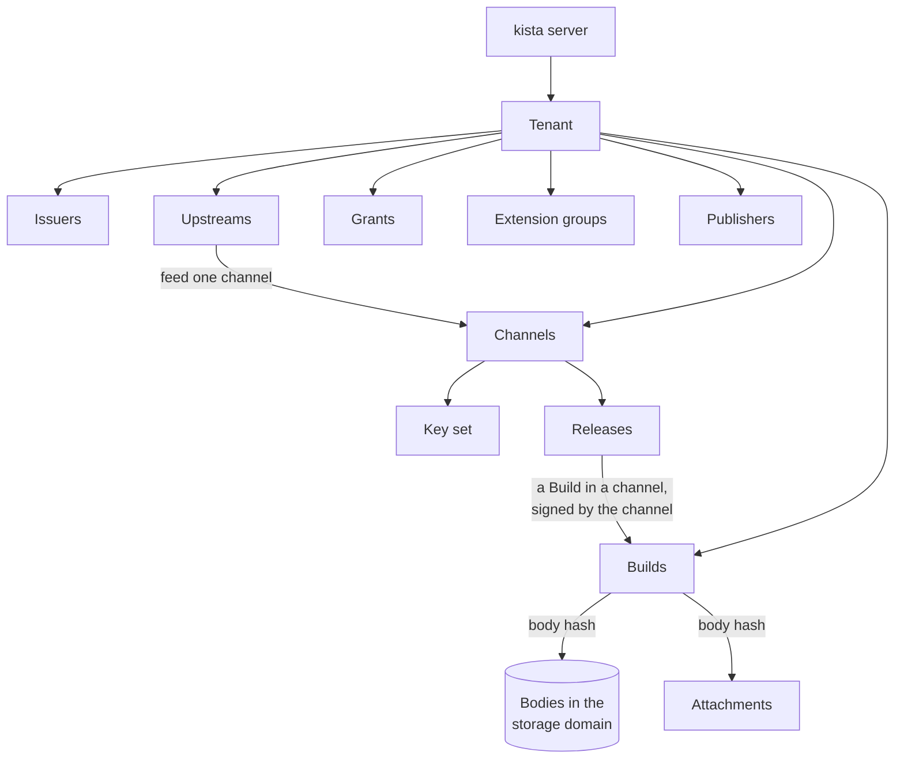

# Concepts

This page names the parts of kista and how they relate. Each section is short and links to the page
that explains how to operate it.

## Tenants

A **tenant** is a namespace: its own channels, issuers, grants, upstreams, publishers and storage
domain. It is the unit of isolation. A self-hosted organisation usually has one tenant; a public
service has many. Server administrators create tenants; a tenant administrator holds `admin` on
the tenant. Tenant and channel names are public, because they are part of every URL.

A tenant can be suspended and resumed. See
[Tenants and channels](administration/tenants-and-channels.md).

## Channels

A **channel** is one DuckDB extension repository inside a tenant, at the prefix
`https://<host>/<tenant>/<channel>`. Typical channels are `prod`, `staging` and `nightly`. A channel
has a list of the DuckDB versions it serves, and one of two kinds:

| Kind | Serves | Used with |
| --- | --- | --- |
| `signed` | each binary with the channel's own signature | `CREATE EXTENSION REPOSITORY`, `INSTALL x FROM r`, `LOAD x FROM r` |
| `passthrough` | DuckDB's core binaries byte-identical, with DuckDB's signature | `custom_extension_repository` / `autoinstall_extension_repository`, so DuckDB can autoload them |

A channel's prefix is permanent: DuckDB records it with each install. See
[Tenants and channels](administration/tenants-and-channels.md).

## Keys

Every signed channel has a **key set**: one active key, which signs new releases, plus trusted
keys. The channel's `.well-known/duckdb-extension-repo.json` lists the active key and every trusted
key, and DuckDB pins them when the repository is created. A key is RSA-2048 and lives in a key source: a key file for
development, HashiCorp Vault / OpenBao Transit, Azure Key Vault / Managed HSM, AWS KMS or Google
Cloud KMS.

A `staging` channel signs whatever a publisher uploads, so its key must never be trusted where the
`prod` key is. Rotation adds a key as trusted, makes it active, re-signs the releases and retires
the old key once clients have reinstalled. See [Signing keys](signing-keys.md) and
[Key rotation](administration/key-rotation.md).

## Builds and releases

A **build** is a body (the extension file without its last 256 bytes, the signature) known under a
name in a tenant: name, extension version, platform, ABI type and DuckDB compatibility, addressed by
its **body hash**. A `CPP` (or `C_STRUCT_UNSTABLE`) build serves one exact DuckDB version; a
`C_STRUCT` build serves every DuckDB version of the channel that accepts its C API version.

A **release** is a build in a channel, signed with that channel's active key. It is `active`,
`deprecated` (served only on the versioned path) or `yanked` (served nowhere). For each DuckDB
version, platform and name, one release is **current**: the one DuckDB gets on the flat path
(`INSTALL x FROM r`). Another version is reached with `INSTALL x FROM r VERSION '…'`.

Versions are immutable: a released name, extension version, DuckDB version and platform never
changes its body in a channel. A fix is a new version. A **block** bans a body hash in every channel
of the tenant at once, for example after a CVE. See [Publishing](publishing.md).

## Publication and promotion

**Publication** uploads a new build into a channel, usually `staging`. kista checks the footer
against the declared extension version and platform (the footer carries no name), and checks that
the binary exports the entry point DuckDB calls for the name it is published under. People publish with a token; CI publishes as a **publisher**, with
trusted publishing (a GitHub Actions OIDC token bound to the repository's ids) or an API key.

**Promotion** releases a build that is already in one channel in another channel of the tenant,
signed with the target channel's key. No body is uploaded again. Promotion needs `promote` on the
name in the target channel and `publish` on the name in the source channel.

DuckDB's core and community names are reserved: publishing under one of them (a replacement
`httpfs`, for example) needs a grant that names it. See [Publishing](publishing.md).

## Upstreams

An **upstream** is a source a tenant takes builds from, feeding one channel: `duckdb-core`
(`extensions.duckdb.org`), `duckdb-community` (`community-extensions.duckdb.org`), or `repository`
(any DuckDB repository, such as another kista, with its keys pinned by fingerprint). It has an
allowlist of names and platforms, and a mode:

- **mirror**: runs on a schedule and on request, fetching every allowlisted cell;
- **pull-through**: fetches a missing build when an authorized caller asks for it.

Every fetched binary must verify with the upstream's keys before it is stored, and its footer must
match the path. In a signed channel it is then re-signed with the channel's key; in a passthrough
channel it is served with DuckDB's own signature. A passthrough channel takes `duckdb-core`
mirrors only. See [Upstreams](upstreams.md).

## Storage domains

Bodies are stored once per **storage domain**, however many channels, tenants and upstreams serve
them; signatures are stored per release. A domain is a local directory, an S3-compatible bucket, an
Azure Blob container or a Google Cloud Storage bucket. Every tenant belongs to one domain (`default` unless given at creation), and
deduplication happens only inside a domain, so data residency can be kept by giving a tenant its own
domain. Bodies no release needs any more are removed by garbage collection. See
[Storage](storage.md).

## Public and private extensions

A release is **public** (served to anyone, also over plain `http`) or **private** (served only over
`https` to a caller whose Bearer token holds `install` on it). The `.well-known` file is always
public.

Inside a channel, nothing tells an outsider whether a private name or version exists: without a
valid token every non-public path answers `401`, with a valid token and no grant it answers `404`,
the same as a missing path. See [Access](access.md) and
[Using kista from DuckDB](duckdb.md#private-extensions).

## Principals and grants

A tenant trusts one or more **issuers**: OIDC / JWT identity providers, each stored as a named
issuer record. A token must carry an audience bound to the tenant, so a token for one tenant never
works at another.

A verified token yields **principals**, each namespaced by the issuer record's name:

| Principal | From |
| --- | --- |
| `subject:<issuer>\|` | the token's subject |
| `role:<issuer>\|<name>` | the issuer's roles claim |
| `group:<issuer>\|<name>` | the issuer's groups claim |
| `client:<issuer>\|<id>` | the issuer's client claim |

A **grant** is principal, resource and verbs. The resource is the tenant, a channel, an extension
name (in every channel or in one) or an extension group (in every channel or in one). The verbs
are:

| Verb | Allows |
| --- | --- |
| `install` | download private releases |
| `publish` | publish under a name (never implied by `admin`) |
| `promote` | promote into a channel |
| `audit` | read the tenant's events |
| `feed` | take the tenant's attachment feed in a channel |
| `admin` | manage the tenant or channel; implies `audit` and `feed` |

See [Access](access.md).

## Extension groups

An **extension group** is a named set of extension names in a tenant, such as all the extensions
one team owns. A grant on the group covers every member, in every channel or in one, and a name
added to the group is covered at once. Only a tenant administrator changes the members. Extension
groups are not the `group:` principals above, which are groups of people from the identity
provider. See [Access](access.md).

## Attachments

An **attachment** is a document about one body: an SBOM, a vulnerability report, a review, a
provenance statement or notes. It is bound to the body hash, so it never applies to another binary,
and it is read only through a release the caller may see. Attachments come from the tenant itself
(an administrator, or a publisher's CI) or, through a **feed**, from another repository that signs
statements about the bodies the tenant holds with its **attestation keys**. See
[Attachments](attachments.md).

## Events

kista records what happens as **events**: installs, publications, promotions, key, grant and
upstream changes. A tenant reads its own events with `audit`; download statistics are counted per
tenant. See [Observability](observability.md).
