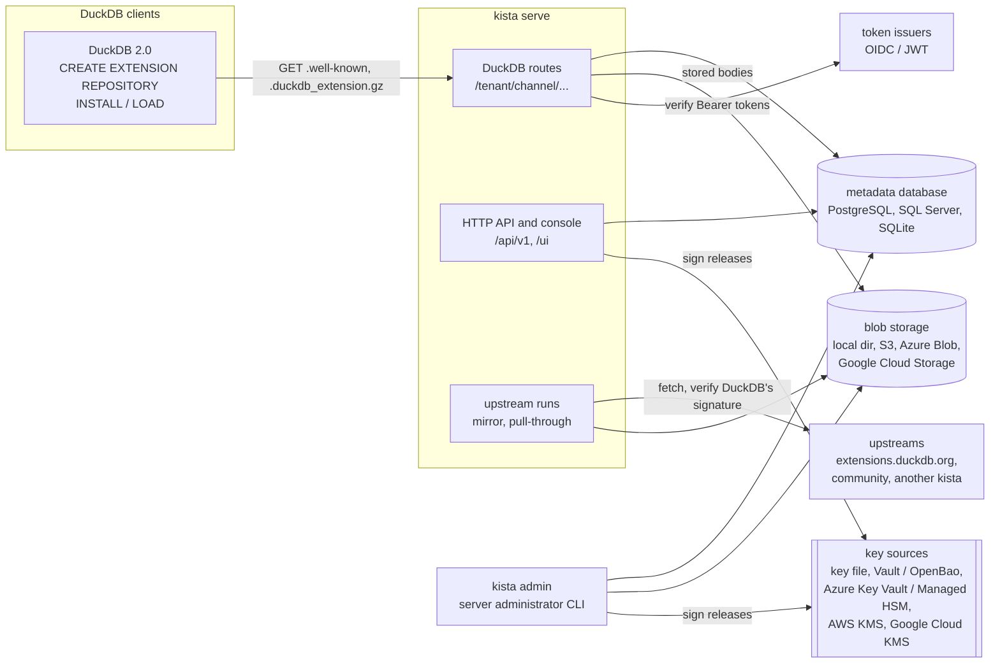

# kista

kista is a trusted repository for [DuckDB](https://duckdb.org) extensions. DuckDB 2.0 uses it with
no plugin: a client names a channel of kista as an extension repository and installs from it.

```sql
CREATE EXTENSION REPOSITORY corp WITH PREFIX 'https://extensions.example.com/acme/prod';
INSTALL my_ext FROM corp;
LOAD my_ext FROM corp;
```

*Kista* is Old Norse / Swedish for "chest".

## What it does

- **Mirrors** the official core and community extensions. DuckDB's signature is verified when a
  binary is taken in, and the binary is then **re-signed with the channel's key**. A signature from
  your repository means "checked and allowed by us", not only "built by DuckDB".
- **Passes core extensions through** unchanged in a passthrough channel, byte-identical to
  `extensions.duckdb.org`, so DuckDB can still autoload them from your own server.
- **Publishes** your own extension builds into signed channels, from the command line, the HTTP API
  or CI (trusted publishing and API keys), and **promotes** a tested build from one channel to
  another.
- Serves **public and private** extensions. A public release is served to anyone; a private one only
  to a caller with a Bearer token from one of the tenant's issuers and an `install` grant. Nothing
  tells an outsider which private extensions exist.
- Keeps **attachments** next to each binary (an SBOM, a vulnerability report, a review), and can
  receive signed statements about the binaries it holds from another repository's feed.
- Records **events** (installs, publications, key and grant changes) and download statistics per
  tenant.

One server holds many **tenants**. A tenant owns **channels** (`prod`, `staging`, ...); each channel
is one DuckDB repository with its own URL and signing key. See [Concepts](concepts.md).

## How the parts fit



- The **metadata database** holds tenants, channels, keys, builds, releases, grants, events and
  signatures. See [State](state.md).
- **Blob storage** holds each extension body once per storage domain, precompressed. Each 1 MiB
  chunk is checked against a digest recorded at intake as it is served. See [Storage](storage.md).
- **Key sources** hold the channel signing keys; a private key in a vault or HSM never leaves it
  (a key file, for development, is read by kista itself).
  Signing happens when a release is made, never per request. See [Signing keys](signing-keys.md).
- **Upstreams** are the sources a tenant mirrors from. See [Upstreams](upstreams.md).
- **Issuers** are the identity providers whose tokens a tenant accepts. See [Access](access.md).

## Where to go next

| You want to | Read |
| --- | --- |
| Run kista on your machine and install an extension from it | [Getting started](getting-started.md) |
| Understand tenants, channels, releases and grants | [Concepts](concepts.md) |
| Use a kista channel from DuckDB | [Using kista from DuckDB](duckdb.md) |
| Write the configuration file | [Configuration](configuration.md) |
| Publish and promote your own builds | [Publishing](publishing.md) |
| Mirror DuckDB core or community extensions | [Upstreams](upstreams.md) |
| Make extensions private and grant access | [Access](access.md) |
| Look up a `kista admin` command | [Commands](administration/commands.md) |
| Automate through HTTP | [HTTP API](api.md) |

The design reasoning is in the
[specs](https://github.com/hugr-lab/duckdb-extension-repository/tree/main/specs), starting with
[spec 0001](https://github.com/hugr-lab/duckdb-extension-repository/blob/main/specs/0001-architecture/spec.md).
These pages say how to run and use kista; the specs say why it works the way it does.

## Status

kista is in early development. Signed and passthrough channels, publication and promotion,
upstreams (mirror, pull-through, private upstreams), tokens and grants, attachments and the feed,
events, storage garbage collection and the administration console are in place. kista ships as
a signed container image and, from the first release, signed binaries for linux and darwin
([Deployment](deployment/index.md)); a Helm chart is to come.

## License

kista is licensed under the Apache License, Version 2.0. Enterest is the hosted service built on
kista.
