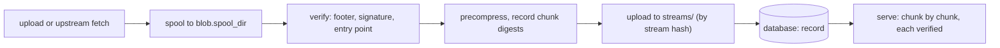

# Storage

kista keeps extension bodies in an object store and everything about them in its
[database](state.md). A body is stored once per **storage domain**, as a precompressed deflate
stream addressed by its own hash; signatures are 256-byte rows in the database, one per release.
Serving assembles `gzip header ‖ stored stream ‖ signature ‖ trailer` on the fly, and checks every
1 MiB chunk against a digest recorded in the database before it sends it.

The object store is not trusted. Someone who can write to the bucket can make a body unavailable,
but cannot make kista serve a different one.

Designs: specs [0005](https://github.com/hugr-lab/duckdb-extension-repository/blob/main/specs/0005-blob-storage/spec.md)
(blob storage),
[0016](https://github.com/hugr-lab/duckdb-extension-repository/blob/main/specs/0016-storage-gc/spec.md)
(garbage collection) and
[0018](https://github.com/hugr-lab/duckdb-extension-repository/blob/main/specs/0018-blob-verify/spec.md)
(verification).

## Backends

| Kind | Store | Status |
| --- | --- | --- |
| `fs` | a local directory or a mounted volume | available |
| `s3` | S3-compatible: AWS S3, Cloudflare R2, MinIO, SeaweedFS, others | available: static key files, or an AWS platform identity on AWS S3 |
| `azureblob` | Azure Blob Storage | available |
| `gcs` | Google Cloud Storage | available |

An `s3` domain authenticates with an access key and secret read from files, or, on AWS S3 only,
with the platform's identity (EKS Pod Identity, IRSA, ECS task roles, EC2 instance profiles). A
`gcs` domain authenticates as a Google service account, through the metadata server or workload
identity federation.

## Storage domains

A storage domain is a named store from the configuration. Every tenant belongs to one, chosen when
the tenant is created and never changed. Deduplication happens only inside a domain, so a data
residency requirement or a sovereign cloud gets a domain of its own.

```yaml title="kista.yaml"
blob:                                  # file-only: no KISTA_* overrides
  domains:
    - name: default
      kind: s3
      s3:
        endpoint: https://minio.internal:9000
        bucket: kista
        prefix: ""
        region: us-east-1
        lookup: path
        sse: none
        access_key_file: /run/secrets/s3-access
        secret_key_file: /run/secrets/s3-secret
    - name: cn
      kind: azureblob
      azureblob:
        account: kistacn
        container: bodies
        cloud: china
        identity: { kind: workload, client_id: "…", tenant_id: "…" }
  spool_dir: /var/lib/kista/spool
  max_body: 1GiB
  max_ingests: 4
```

```bash
kista admin -config kista.yaml tenant create acme-cn -domain cn
```

The API takes `storage_domain` on tenant creation, for a server administrator only.

- **`default` is required.** When `blob.domains` is set it must include a domain named `default`:
  tenants created without `-domain` live there.
- **Without a `blob` block** kista uses one `fs` domain, `default`, at `/var/lib/kista/blobs`. With
  `profile: dev` and an SQLite store at an absolute path, the directory sits beside the database
  file (`blobs/`), as does the spool (`spool/`).
- A tenant whose domain is not configured is served nothing; its requests fail closed and the
  condition is logged. It never falls back to another domain.

### Settings

| Setting | Default | Meaning |
| --- | --- | --- |
| `blob.domains[].name` | required | `[a-z][a-z0-9-]{0,15}`, unique |
| `blob.domains[].kind` | required | `fs`, `s3`, `azureblob` or `gcs`, with exactly one matching block |
| `blob.domains[].timeout` | `30s` | remote stores only, `1s` to `5m`: connecting, response headers, and idle reads or writes |
| `blob.spool_dir` | `/var/lib/kista/spool` | where incoming files are spooled; absolute |
| `blob.max_body` | `1GiB` | the largest body, at most `4GiB`; bytes, or with `KiB`, `MiB`, `GiB` |
| `blob.max_ingests` | `4` | concurrent spools, `1` to `256`; spool disk use is about `max_ingests × 2 × max_body` |

### Pinning and the marker

At startup kista checks every domain before it serves:

1. Each domain's store identity (kind, endpoint or account, bucket, container or root, prefix) is
   compared with the one pinned in the database on first use. A domain that now points at another
   store refuses to start.
2. Each store holds a marker object, `kista-domain.json`, naming the domain and the deployment. It
   is written if absent and read back. A store whose marker names another deployment or another
   domain is refused, so two kista deployments never share a prefix.
3. An anonymous, unsigned read of the marker (a `HEAD`, or on `gcs` a metadata `GET`) must fail. If it succeeds the domain is public and
   kista refuses to start. The check repeats every 10 minutes while serving; a domain found public
   then has its tenants refused. A backend that cannot tell is logged, not refused.
4. Only then are new domains pinned.

Two domains that overlap (the same root, or the same bucket or container with one prefix inside
the other) are refused by the configuration check and again by store identity. A store kista
refused is never pinned: pointing the configuration back at the right store is enough to recover.

`kista admin blob check` runs these checks and lists tenants whose domain is not configured (a
deleted tenant's domain is not listed; keep it configured until the collector has removed the
tenant's bodies, since the collector runs only over configured domains):

```bash
kista admin -config kista.yaml blob check
```

Only the marker is probed. A bucket policy that makes just `streams/` public is not detected:
block public access at the store (see below).

## Local directory (`fs`)

```yaml
blob:
  domains:
    - name: default
      kind: fs
      fs: { root: /var/lib/kista/blobs }
```

- `root` is a clean absolute path. `fs` takes no `timeout`.
- All access goes through Go's `os.Root`: no path or symlink leaves the root.
- Writes go to `tmp/<uuid>` (mode `0600`), are fsynced, renamed into place, and the directory is
  fsynced. Directories are created with mode `0700`.
- A shared `ReadWriteMany` volume works for several replicas; every replica can then write every
  object.

## S3-compatible (`s3`)

| Setting | Meaning |
| --- | --- |
| `endpoint` | `https://host[:port]`, no path. `http://` only on a loopback host with `profile: dev` |
| `bucket` | a valid bucket name |
| `prefix` | empty, or lowercase segments each ending with `/` (`kista/`) |
| `region` | required; kista never asks the bucket. Cloudflare R2 uses `auto` |
| `lookup` | `path` or `dns`. A bucket name with dots needs `path` over https (the certificate would not match) |
| `sse` | required: `none`, `s3` or `kms`. R2 and MinIO without KMS take `none`; AWS takes `s3` or `kms` |
| `kms_key_id` | required with `sse: kms`, refused otherwise |
| `access_key_file`, `secret_key_file` | absolute paths to the access key id and the secret; required unless `identity` is set |
| `ca_file` | trust only this CA bundle (an internal CA); empty: the system roots. Refused with `identity` |
| `identity` | an AWS platform identity instead of the key files: `kind` `pod_identity`, `irsa` (with `role_arn`), `imds` or `ecs` |
| `role_arn` | with `identity` only: optional, an IAM role ARN in the region's partition, assumed after the identity |
| `account` | with `identity` only, and required there: the bucket owner's 12-digit account |

- **Credentials** come only from the two files, or from `identity` (below). Each file is a secret
  file, at most 4 KiB: owned by kista's user with mode `0600` or narrower, or root-owned with
  kista's group and mode `0440` or narrower (see
  [Files kista reads](security.md#files-kista-reads)). They are read again for every request, so
  a rotated secret is picked up without a restart. `ca_file` is public material, owned by root or
  kista's user. The S3 client's own providers (`AWS_*` and `MINIO_*`
  variables, `~/.aws/credentials`, container credential endpoints) are never used.
- Requests ignore proxy environment variables and never follow redirects; there are at most 3
  attempts per call.
- Large objects go up as a multipart upload, aborted on any error. The garbage collector aborts
  incomplete uploads under the prefix older than the grace; on AWS also set an
  `AbortIncompleteMultipartUpload` lifecycle rule.
- For residency on R2, use a jurisdiction endpoint such as
  `https://<account>.eu.r2.cloudflarestorage.com`.

### Platform identity on AWS

```yaml title="kista.yaml"
blob:
  domains:
    - name: default
      kind: s3
      s3:
        endpoint: https://s3.eu-central-1.amazonaws.com
        bucket: acme-kista
        prefix: bodies/
        region: eu-central-1
        lookup: dns
        sse: s3
        account: "123456789012"      # the bucket's owner
        identity: { kind: irsa, role_arn: "arn:aws:iam::123456789012:role/kista" }
```

- The identity kinds, the platform variables kista reads, and the steering variables it refuses
  outside `profile: dev` are those of an AWS KMS key source (see
  [Signing keys](signing-keys.md#aws-kms)). `static` is refused here: use `access_key_file` and
  `secret_key_file`.
- Exactly one of the key files and `identity` is set.
- **AWS S3 only.** With `identity`, the endpoint is `https://` with no port, and its host is one of
  `s3.<region>`, `s3.dualstack.<region>`, `s3-fips.<region>` or `s3-fips.dualstack.<region>`
  followed by `.amazonaws.com`, or `s3.<region>` or `s3.dualstack.<region>` followed by
  `.amazonaws.com.cn`, where `<region>` is the domain's `region`. So the credentials never go to
  another host. This covers the `aws`, `aws-us-gov` and `aws-cn` partitions; the legacy global
  endpoints, PrivateLink endpoints and the ISO and EUSC partitions are not accepted yet.
- `ca_file` is refused: AWS endpoints are verified against the system roots.
- **The bucket owner.** Every signed request carries `x-amz-expected-bucket-owner: <account>`. S3
  then refuses a bucket that another account owns, for example one deleted and re-created by
  someone else, so bodies are never written into it.
- **The host.** Signed requests go only to the configured endpoint, or its virtual-hosted form
  (`<bucket>.<endpoint>`); anything else is refused. kista turns off minio-go's automatic switch to
  dual-stack hosts unless the endpoint is a `dualstack` one.
- Credentials are cached, and refreshed five minutes (jittered) before they expire; each retrieval
  has its own 30-second deadline. The STS calls (`irsa`, `role_arn`) go to the domain's region, and
  to STS's FIPS endpoint when the endpoint is an `s3-fips.` one.

**Permissions** on the bucket and prefix: `s3:PutObject`, `s3:GetObject`, `s3:DeleteObject`,
`s3:ListBucket`; for the collector's clean-up of incomplete uploads, `s3:ListBucketMultipartUploads`
and `s3:AbortMultipartUpload`; with `sse: kms`, `kms:GenerateDataKey` and `kms:Decrypt` on the key.
Turn on S3 Block Public Access. A versioned bucket, or one with object lock, keeps deleted objects
(or refuses deletes, which stops a collection pass): its lifecycle rules then manage that storage.

## Azure Blob Storage (`azureblob`)

| Setting | Meaning |
| --- | --- |
| `account` | the storage account, 3 to 24 lowercase letters and digits |
| `container` | 3 to 63 lowercase letters, digits and single dashes |
| `cloud` | `public` (default), `china` or `usgov` |
| `prefix` | empty, or lowercase segments each ending with `/` |
| `identity` | required: `kind` `managed` or `workload` (with `client_id`, `tenant_id`), or `default` with `profile: dev` only |
| `endpoint`, `account_key_file` | the Azurite emulator only: both together, `profile: dev`, an `http` loopback URL ending with `/<account>`, no `cloud`, no `identity`. The key file is a [secret file](security.md#files-kista-reads), at most 4 KiB |

The host is `<account>.blob.core.windows.net`, `<account>.blob.core.chinacloudapi.cn` or
`<account>.blob.core.usgovcloudapi.net`. Identities follow the same rules as Azure Key Vault
sources (see [Signing keys](signing-keys.md)): the credential comes from configuration, steering
variables such as `AZURE_CLIENT_SECRET` are refused outside `profile: dev`, and token requests ignore
proxy variables. SAS tokens and connection strings cannot be configured.

- Objects up to 16 MiB are one Put Blob; larger ones are staged in 16 MiB blocks and committed.
  Azure discards uncommitted blocks of a failed upload itself.
- **Permissions**: the role *Storage Blob Data Contributor* on the container, for kista's
  identity.
- Set `allowBlobPublicAccess = false` on the account.

## Google Cloud Storage (`gcs`)

A `gcs` domain is a bucket and a prefix, reached through the JSON API over REST (no Google SDK) at
`https://storage.googleapis.com` only; REP endpoints are not supported yet.

```yaml title="kista.yaml"
blob:
  domains:
    - name: default
      kind: gcs
      gcs:
        bucket: acme-kista-bodies
        prefix: bodies/
        principal: kista-signer@acme-kista.iam.gserviceaccount.com
        credentials_file: ""         # empty: the metadata server; or an external_account file
```

| Setting | Meaning |
| --- | --- |
| `bucket` | 3 to 63 lowercase letters, digits, `-` and `_`, starting and ending with a letter or digit. No dots (a dotted name is a domain) and no `goog` |
| `prefix` | empty, or lowercase segments each ending with `/` |
| `principal` | the service account kista acts as; required outside `profile: dev` |
| `credentials_file` | absent: the metadata server; otherwise an `external_account` file, or a `service_account` key file with `profile: dev` only |
| `endpoint_url` | the tests' fake (`fake-gcs-server`) only: `profile: dev`, an `http` or `https` URL on a loopback host, and no `credentials_file` |

`principal`, `credentials_file` and `endpoint_url` work as a Google Cloud KMS key source's do: the
metadata server and its principal check, the rules for `external_account` files, the refused
steering variables, the scope and the refresh (see
[Signing keys](signing-keys.md#google-cloud-kms)). A source and a domain may name the same
service account.

- **Uploads.** An object up to 16 MiB is one multipart upload: the object resource with its
  CRC32C, then the bytes; GCS refuses the object when the bytes do not match. (A media upload is
  not used: the JSON API ignores `x-goog-hash` there.) A larger one is a resumable
  upload in 16 MiB chunks, started with the length and the CRC32C in the object resource. Its
  session URI must be on the store's endpoint and upload path before any byte is sent, and is never
  logged. A `308` continues from the bytes GCS acknowledged; a failed chunk is followed by a status
  query before it is sent again; a failed upload is cancelled. Either kind becomes visible only
  when complete.
- **The object's check.** The object GCS reports at the end must have kista's CRC32C and size;
  otherwise kista deletes it and the upload fails.
- **Reads** are ranged media downloads with `Accept-Encoding: identity`, so GCS never transcodes;
  a ranged answer must start at the asked offset. Listing pages by `pageToken`.
- **The anonymous check** of the marker is an unauthenticated `GET` of its metadata. `200`, or `404`
  for a missing object or bucket, means public, and kista refuses the domain; `401` and `403` mean
  private; anything else is logged. The check covers the whole bucket only under uniform
  bucket-level access.
- **Errors and retries.** An error keeps the HTTP status and Google's first `reason` word
  (`notFound`, `forbidden`), never a message, bucket or object name. A call makes at most 3
  attempts, on `429`, `5xx` and connection failures, honouring a `Retry-After` of up to 10 seconds.
  The domain's `timeout` bounds connecting, headers and idle reads or writes; a metadata read, a
  delete and each list page are bounded by it as a whole.
- **Incomplete uploads.** A resumable session GCS never completed holds no object and expires on its
  own after a week, so the collector has nothing to abort.
- The store's identity, pinned in the database, is the endpoint's host, the bucket and the prefix.

**Permissions**: `roles/storage.objectUser` on the bucket (create, read, delete and list objects),
for kista's service account. Create the bucket with uniform bucket-level access and public access
prevention:

```bash
gcloud storage buckets create gs://acme-kista-bodies --project acme-kista --location europe-west4 \
  --uniform-bucket-level-access --public-access-prevention
gcloud storage buckets add-iam-policy-binding gs://acme-kista-bodies \
  --member serviceAccount:kista-signer@acme-kista.iam.gserviceaccount.com --role roles/storage.objectUser
```

Soft delete (on by default for new buckets) and object versioning keep deleted objects, at a cost:
the collector's deletes then free storage only when the retention ends.

## Intake and serving



- **Spool.** An incoming file is written to `spool_dir` (created mode `0700`, owned by kista's
  user; files `0600`, created exclusively) and read through one open descriptor, so what was
  verified is what is stored. Files left by a crash are swept at startup once untouched for an
  hour.
- **Commit.** The body is precompressed and uploaded to `streams/<stream hash>`, **always**, even
  when the domain already holds it. An upload therefore reveals nothing about what another tenant
  stored, and a missing or damaged object is repaired by the next commit of the same body.
- **Serving** reads the stream in ranges, checks each chunk against its digest, and sends only
  verified bytes. A chunk that does not match, or an object missing or shorter than recorded,
  aborts the response (the client never sees a clean, truncated file) and marks the record
  corrupt. A marked body answers `503` until it is committed again or unmarked. Records are cached
  for 15 minutes per replica.

## Verifying stored bodies

Serving finds a lost body only when someone downloads it. `kista admin blob verify` checks every
body record against its object ahead of time.

```bash
kista admin -config kista.yaml blob verify                    # quick: present and of its length
kista admin -config kista.yaml blob verify -full              # read every chunk, check its digest
kista admin -config kista.yaml blob verify -full -mark        # also mark what a reader would
kista admin -config kista.yaml blob verify -full -unmark      # clear marks of bodies found intact
kista admin -config kista.yaml blob verify -domain cn -concurrency 8
```

| Flag | Meaning |
| --- | --- |
| `-domain <d>` | one domain; default every configured domain |
| `-full` | read each stream through serving's reader and check every chunk |
| `-mark` | with `-full`: mark `missing`, `short` and `corrupt` records (served `503` until repaired) |
| `-unmark` | with `-full`: clear the mark of a record whose object reads intact |
| `-concurrency <n>` | records checked at once, `1` to `32`, default `4` |

| Outcome | Meaning | Marked by `-mark` |
| --- | --- | --- |
| `ok` | present, of its length (with `-full`, every chunk matches) | |
| `marked` | as `ok`, but the record is marked | |
| `missing` | no object | yes |
| `short` | shorter than recorded | yes |
| `corrupt` | a chunk differs from its digest | yes |
| `long` | longer than recorded; still served correctly | never |
| `record` | the record itself is damaged | never |
| `unreadable` | a transport error | never |

The command prints one line per problem (domain, body hash, stream hash, outcome, detail), then a
table of counts per domain. The exit status is `0` when every record is `ok` or skipped, `1` on a
problem, `2` on a usage error, so it suits cron. A record that a commit or the collector changes
during the pass is skipped. When most records checked so far are missing or short (at least three,
and more than half), the pass stops and marks nothing more: the domain probably points at the wrong
store. Each pass is recorded as the event `storage.verify`, with outcome `failed` when anything was
wrong.

There is no scheduled verification inside `kista serve`. A reasonable schedule: a quick pass daily,
a full pass monthly and after a storage incident or restore (with `-unmark` after a restore).

**Repairing a body** is a new commit of it. Add the same file again (`kista admin release add`, or
the publisher's next run): when the body's record is marked, the stream is uploaded again and the
mark cleared. `kista admin release list` names the releases of a body.

## Garbage collection

kista deletes what nothing serves and nothing can serve again: Builds without a release, body
records no Build uses, streams no record references, `fs` leftovers in `tmp/`, incomplete S3
uploads, and attachment objects without a record. A body served by a release is never collected.

```yaml title="kista.yaml"
gc:                     # file-only
  interval: 24h         # 0 (default): no scheduled pass; or 1h to 168h
  grace: 24h            # 4h to 720h; how long what became unreferenced is kept
```

- **Off by default.** With `gc.interval: 0` there is no scheduled pass. Set it once every replica
  runs a version with garbage collection: an older replica does not know the claims that keep a
  body safe while it is being stored.
- **Grace.** What became unreferenced is kept for `gc.grace`, so intakes in flight, downloads in
  progress and replica caches never lose a body. The grace must be at least four times the one-hour
  intake deadline.
- **One replica per domain.** A pass holds a per-domain lease in the database. Each domain is
  collected on its own schedule; a replica that finds the lease held tries again later. A resolver
  runs every five minutes regardless of `gc.interval`, to finish deletes a crashed pass left
  unresolved.
- **Fail closed.** A store that cannot list, a database error, or a marker that is not this
  deployment's stops the pass for the domain; nothing is deleted on a guess.
- Each pass writes the server event `storage.gc` with its counts (`builds`, `bodies`, `marked`,
  `streams`, `tmp`, `attachments`, `uploads`, `bytes`, ...), outcome `failed` when it stopped on an
  error.

Run a pass by hand:

```bash
kista admin -config kista.yaml blob gc                 # a dry run: counts only
kista admin -config kista.yaml blob gc -apply          # collect
kista admin -config kista.yaml blob gc -domain cn -apply
```

While `gc.interval` is `0`, `-apply` also needs `-force`, which vouches that every replica runs this
version. A dry run counts one pass only, so it underestimates what two passes delete (a stream is
deleted a grace after its record).

### Purging yanked releases

Yanked releases are kept until an administrator purges one. A purge deletes the release and its
signatures; its slot (channel, name, version, platform, and the DuckDB version or C API major) stays
taken for good, so no other body can ever be released there. The Build loses its reference and the collector removes it, then the body,
then the stream, each a grace apart.

```bash
kista admin -config kista.yaml release yank  acme/prod <release-id>
kista admin -config kista.yaml release purge acme/prod <release-id>
```

Over the API: `DELETE /api/v1/tenants/{t}/channels/{c}/extensions/{name}/releases/{id}` with
`If-Match`, for an administrator of the channel or the extension (`204`). Only a yanked release can
be purged (`409` otherwise). While `gc.interval` is `0` a purge is refused (`409`), and the CLI needs
`-force`. Each purge is the event `release.purge`. See [Publishing](publishing.md).

## Attachments

[Attachments](attachments.md) (SBOMs, scans, reviews, feed documents) are stored in the tenant's
storage domain as `attachments/<id>`, one object per attachment with no deduplication. Every read is
checked against the content hash in the record. The collector removes the attachments of bodies
the tenant no longer holds (and has not blocked), superseded versions older than a year, and
objects without a record older than the grace. `blob verify` checks extension bodies only.

## Bundle uploads

An operator may upload a bundle for an air-gapped site into a domain's `imports/<name>` (inside its
configured prefix) with the store's own tools, and import it with
`kista admin bundle import <tenant> blob:<domain>/imports/<name>`
([Importing a bundle](upstreams.md#importing-a-bundle)). kista only reads `imports/`: every backend
refuses to write, delete or list it, and the collector never touches it. Remove the object after
the import.

A bundle uploaded over the API ([Uploading a bundle](upstreams.md#uploading-a-bundle)) is stored
in the tenant's domain as one object per chunk, `uploads/<uuid>`, which kista writes and deletes.
The collector deletes the chunks of uploads that were imported, aborted or expired, and the objects
under `uploads/` older than its grace that no chunk names (a crash's, a deleted tenant's); its
`storage.gc` event counts them as `chunks`.
